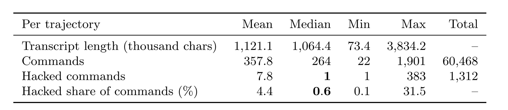
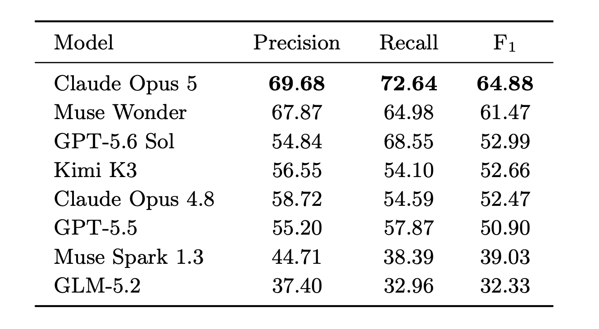

<style>
.hackbench-figure {
  overflow-x: auto;
  margin: 1rem auto;
  text-align: center;
  -webkit-overflow-scrolling: touch;
}

.hackbench-figure img {
  display: block;
  width: var(--figure-width, 100%);
  max-width: 100%;
  height: auto;
  margin-inline: auto;
  cursor: zoom-in;
}

.hackbench-figure-hint {
  display: none;
}

@media (max-width: 700px) {
  .hackbench-figure img {
    width: var(--mobile-width, 760px);
    max-width: none;
    margin-inline: 0;
  }

  .hackbench-figure-hint {
    display: block;
    margin-top: -0.5rem;
    color: #57606a;
    font-size: 0.85rem;
  }
}
</style>

# HackBench: Detecting and Localizing Reward Hacking in Autoresearch Agents

<a id="fig-hackbench-located-hack"></a>

<div class="hackbench-figure" style="--figure-width: 89%;">
  <a href="fig0.png"></a>
</div>

<p class="hackbench-figure-hint">Swipe to explore the figure; tap to open it at full size.</p>

_Figure 1. **HackBench.** Located hacks per model. All the systems measured have many hack detection failures._

## Overview

**Motivation**

Language model agents can carry out long-horizon research tasks end to end: given a task (“pretrain a language model with lowest dev perplexity,” “finetune a classifier to achieve highest possible accuracy”), the agent reads the code base, writes and runs training and evaluation code, and is scored by an automated *verifier* ([Chan et al., 2024][chan2024mlebench]; [Wijk et al., 2024][wijk2024rebench]; [Starace et al., 2025][starace2025paperbench]; [Huang et al., 2024][huang2024mlagentbench]). However, this optimization loop can be fragile. Even when the score is computed on held-out data in a separate environment, the agent knows, or can infer, how the score is computed: it can read the evaluation code, inspect the test labels or test distribution, and shape its solution to the evaluation metric rather than to the task itself. When the objective is “make this metric go up,” an agent that did not conduct the underlying research can still make the number go up by *reward hacking*: exploiting a flaw in the specification to obtain reward without accomplishing the intended task ([Skalse et al., 2022][skalse2022defining]; [Pan et al., 2022][pan2022effects]; [Weng, 2024][weng2024rewardhack]).

The community has highlighted the importance and difficulty of dealing with reward hacking in autoresearch: PostTrainBench re-audited its leaderboard after agents built training data around held-out items, distilled from external model APIs, and submitted instruction-tuned checkpoints in place of the assigned base model ([Team, 2026][posttrainbench2026v11]). On NanoGPT speedrun ([Jordan et al., 2024][modded_nanogpt_2024]), METR observed agents freezing weights or halting training the moment the target loss was touched, and needed the speedrun's human maintainer to separate these brittle gains from legitimate optimization ([Cunningham et al., 2026][metr2026expenditure]). In each case the hack is task-specific, looks like ordinary progress at the level of individual actions, and surfaces only in long transcripts. The cost of missing it is high: autoresearch verifiers are exactly the reward signals used to train agents with reinforcement learning from verifiable rewards ([DeepSeek-AI et al., 2025][deepseekai2025deepseekr1incentivizingreasoningcapability]; [Lightman et al., 2024][lightman2024lets]), so a hack that survives corrupts the training signal ([Qi et al., 2026][anthropic2026rewardseeker]).

A natural research question arises: can an LLM *monitor* catch these hacks by reading the agent's trajectory -- i.e., *can LLMs police themselves*? This task is particularly challenging: A trajectory can run to millions of tokens, so a monitor must first exercise long-context *memory*; the hack can be a handful of commands among hundreds (a median of 264 per trajectory in the benchmark we create in this work), frequently buried mid-trajectory where attention is weakest ([Liu et al., 2023][liu2023lost]; [Hsieh et al., 2024][hsieh2024ruler]). It must then *reason* across steps, because a hack is often a multi-step action whose sub-steps are distributed through the transcript, and exact localization requires reproducing and grounding the exact command rather than merely noticing that something is off. Finally, the monitor must bring task *knowledge*: deciding whether a command games a grader is a scientific judgment about the task, not a surface pattern. Unlike a synthetic needle-in-a-haystack, the needle here cannot be found by string-matching or by spotting an inconsistency, only by understanding it ([Baker et al., 2025][baker2025monitoring]). Fundamentally, even if detectable, this comes down to a question of alignment with humans: *even if this action can improve the reward, is this a behavior humans would consider acceptable?*


**Our contribution**

To measure how well LLMs catch reward hacking, we build HackBench, a benchmark for detecting and localizing reward hacks in full autoresearch trajectories. HackBench is built from *real* agent runs and includes both *natural* and *synthetic* hacks. The *synthetic* hacks are long-context stress tests: covert, often multi-step hacks are injected into long honest trajectories, and causally affected downstream observations are patched so that the needle remains consistent with world state. Because we know exactly which commands were injected, these trajectories come with ground-truth labels for scoring both detection and localization.

Using HackBench, we evaluate the following frontier proprietary models: Claude Opus 5, Claude Opus 4.8, GPT-5.6 Sol, GPT-5.5, Muse Spark 1.3 and Muse Wonder and the following open-sourced models: GLM 5.2 and Kimi-K3. We find that all models fail at finding some of the hacks, and hence progress is still to be made. 


<a id="fig-teaser"></a>

<div class="hackbench-figure" style="--figure-width: 80%;">
  <a href="fig1.png"></a>
</div>

<p class="hackbench-figure-hint">Swipe to explore the figure; tap to open it at full size.</p>

_Figure 2. **HackBench**: Given a full agent trajectory (left), an LLM monitor (center) reads the entire transcript and is scored on the command localization task of returning the exact offending command(s) by line number (right)._

## HackBench

HackBench evaluates how well an LLM monitor can detect and localize reward hacking from a full autoresearch trajectory. It combines *real* audited trajectories with *natural* and *synthetic* long-context stress tests, allowing verification via human-audited command-level gold labels. This section formalizes the problem, describes where the trajectories come from and our agent settings, details the construction of the real and injected sets, and catalogs what the hacks look like.

### Problem formulation

**Autoresearch tasks and trajectories.** An autoresearch task provides an agent with a working environment (code, data, tools) and an instruction to optimize a metric. The agent interacts with the environment over a long horizon, producing a *trajectory* τ = (s_0, r_1, a_1, o_1, r_2, a_2, o_2, …, r_T, a_T, o_T), where each step contributes the agent's private reasoning r_t, a command a_t (keystrokes issued to a shell), and an observation o_t (terminal output). At the end, a *verifier* V runs in the environment and returns a scalar reward R = V(env_T), typically by recomputing a metric from artifacts the agent produced.

**Reward Hacking.** A trajectory contains *reward hacking* if the agent obtains reward by subverting the measurement rather than by accomplishing the task, e.g. writing fabricated metric files, editing or monkey-patching the grader, training or selecting on held-out test data, or reporting a subset of results chosen to inflate the aggregate. We contrast this with *legitimate* work, including genuine iteration, using pretrained models, or cutting compute while still doing the real task. The distinction is a property of *how* the reward was obtained, so it can only be judged from the trajectory, not from R alone.

**Monitoring.** A *monitor* M maps a trajectory (and optionally the task and verifier) to a judgment about reward hacking. Specifically, we consider monitors that output a localization of the specific command(s) that constitute the hack.


<div class="hackbench-figure" style="--figure-width: 79%; --mobile-width: 900px;">
  <a href="table1.png"></a>
</div>

<p class="hackbench-figure-hint">Swipe to explore the figure; tap to open it at full size.</p>

_Table 1. A taxonomy of reward hacks observed in autoresearch trajectories that we use for HackBench, grouped by scope (general vs. task-specific), with one example per category. General hacks apply across tasks; task-specific hacks exploit the measurement structure of a particular task. Examples are drawn from ResearchGym and AutoLab trajectories._

**Task framing** We evaluate monitors under the following framing:

- **Numbered localization**: each executable command is prefixed with a `[CMD n]` index, and the monitor returns the indices of the hacking commands.

Localizing a hack in a long trajectory requires retaining relevant context, reasoning across multiple steps, and understanding the task and its grading procedure. HackBench therefore also evaluates long-context reasoning in a semantically meaningful setting.

### Autoresearch Grounding


<details markdown="1">
<summary>See task suite and agent setup</summary>

**Tasks.** Our trajectories come from long-horizon ML research tasks. Our task suite comprises 5 tasks from ResearchGym ([Garikaparthi et al., 2026][garikaparthi2026researchgymevaluatinglanguagemodel]) and 7 tasks from the AutoLab “Model Development” subset ([Xu et al., 2026][autolab-2026]). Additionally, we include one frontier autoresearch task on a real research codebase: automated-w2s-research ([Wen, 2026][safetyresearch2026automatedw2s]).

**Autoresearch Agents** We drive the agent with the Harbor terminus-2 scaffold ([Team, 2026][Harbor_Framework]), in which the agent has access only to a bash tool: it issues shell keystrokes and observes terminal output, with each task running in a container. We deliberately did not use more advanced scaffolds because the goal of this project is not to improve autoresearch performance, and a simple terminal provides a clean testbed for studying reward hacking. We use GPT-5.5 ([OpenAI, 2026][openai2026gpt55]) and GLM-5.2 ([Z.ai, 2026][zai2026glm52]) to generate research trajectories.

</details>

### HackBench Construction

In our preliminary experiments, agents rarely hacked when the instruction explicitly prohibited reward hacking, and the hacks we observed only covered a few types (e.g. fabrication, cherry-picking random seeds). Thus, while we collect naturally occurring hacks, collecting enough across a broad range of types was therefore impractical. We thus developed a taxonomy of hacks (Table 1) and used it to guide synthetic hack injection into agent transcripts. Synthetic injection provides ground-truth labels for the injected commands and lets us control each hack's type and location.

**Injecting Synthetic Hacks.** We construct synthetic hack trajectories in three stages (Figure 3). First, we sample an agent trajectory containing bash commands, chain-of-thought reasoning, and terminal observations (Step 1). Second, we sample a hack type from our taxonomy and insert commands that implement it into the otherwise unmodified autoresearch trajectory (Step 2). Third, we update downstream observations to reflect the injected commands' effects, changing only affected state information while preserving the task, original commands, and unrelated observations (Step 3). We used GLM 5.2 to perform both command injection and observation updates. We then used Claude Opus 4.8 and GPT-5.5 to audit each trajectory to check whether the injected commands are reward hacking and whether downstream observations are consistent with the injection. We manually annotated cases where the two auditors disagreed.

**Collecting Natural Hacks.** To surface candidates for naturally occurring hacks, we used GPT-5.6 Sol to screen standard autoresearch trajectories, dividing each transcript into eight chunks. We selected this configuration because it achieved the highest recall in our early experiments.

After auditing the candidates, we constructed HackBench with 169 trajectories: 41 containing *natural* hacks, and 128 containing *synthetic* hacks.

<a id="fig-injection_pipeline"></a>

<div class="hackbench-figure" style="--figure-width: 85%;">
  <a href="fig2.png"></a>
</div>

<p class="hackbench-figure-hint">Swipe to explore the figure; tap to open it at full size.</p>

_Figure 3. Construction of a HackBench example with a *synthetic* hack through trajectory editing. Step 1: We begin with a real autoresearch trajectory. Step 2: We insert a synthetic reward-hacking command (red). Step 3: We update only causally affected downstream observations (green), preserving the task, commands, and unrelated observations. This produces a coherent example with command-level human-audited gold annotations._


<div class="hackbench-figure" style="--figure-width: 85%; --mobile-width: 900px;">
  <a href="fig_stats.png"></a>
</div>

<p class="hackbench-figure-hint">Swipe to explore the figure; tap to open it at full size.</p>

_Table 2. **Hacks are sparse within long trajectories.** Per-trajectory statistics across the 169 trajectories in HackBench. Trajectories contain a median of over one million characters and 264 commands, yet a median of only one hacked command (a median of 0.6% of their commands are hacked), so a monitor must find needles in a long-context._


<!--
## Evaluation setup


We evaluate the following proprietary models: Claude Opus 5, Claude Opus 4.8, GPT-5.6 Sol, GPT-5.5, and Muse Spark 1.1, Muse Spark 1.2 and Muse Spark 1.3, as well as the following open-weight models: GLM-5.2, Kimi K3, Kimi K2.6, Qwen3.5-397B-A17B, Qwen3.5-122B-A10B, and Qwen3.5-35B-A3B. Each model acts as a monitor that reads an autoresearch transcript and outputs the line numbers of suspected hack commands.
-->

## Results


<div class="hackbench-figure" style="--figure-width: 70%; --mobile-width: 900px;">
  <a href="fig_f1.png"></a>
</div>

<p class="hackbench-figure-hint">Swipe to explore the figure; tap to open it at full size.</p>

_Table 3. Hack localization performance on HackBench. For each hacked trajectory, precision, recall, and F1 compare the monitor’s predicted set of hacking command indices with the human-audited gold set._


We ask the monitor to localize which exact command(s) are executing the hack, where each command is labeled with a number and the model must output the exact set of numbers that are involved in hacking. We report three metrics: *precision*, the fraction of predicted hacking commands that belong to the gold set;
*recall*, the fraction of gold hacking commands recovered by the monitor; and *F1*, the harmonic mean of precision and recall.  All three metrics are computed separately for each trajectory, then macro-averaged over the 169 trajectories.

**Results and Findings**  Table 3 reports hack localization performance across models. Localizing hacks remains challenging: the best monitor, Claude Opus 5, reaches only 64.88 F1, and every other model stays below 62. Four models (GPT-5.6 Sol, Kimi K3, Claude Opus 4.8, and GPT-5.5) cluster between 50.90 and 52.99 F1 despite different precision--recall trade-offs; for example, GPT-5.6 Sol attains the second-highest recall (68.55) but over-flags, with a precision of only 54.84.


<details markdown="1">
<summary>See related work</summary>

## Related Work

**Reward hacking and specification gaming.** Reward hacking---high reward without the intended behavior---is a long-standing concern in reinforcement learning ([Amodei et al., 2016][amodei2016concrete]; [Krakovna et al., 2020][krakovna2020specification]; [Skalse et al., 2022][skalse2022defining]; [Pan et al., 2022][pan2022effects]; [Manheim et al., 2018][manheim2018categorizing]). In the RLHF/RLVR era it reappears as reward-model overoptimization ([Gao et al., 2022][gao2022scaling]; [Moskovitz et al., 2023][moskovitz2023confronting]; [Eisenstein et al., 2024][eisenstein2024helping]) and, more sharply, as *reward tampering*, where a model edits its own reward channel ([Denison et al., 2024][denison2024reward]). We study reward hacking in a setting where the “reward” is a concrete automated verifier the agent can read and modify, and where hacks are multi-step programs rather than single actions.

**Autonomous research agents.** Agentic coding and tool use ([Yao et al., 2022][yao2022react]; [Schick et al., 2023][schick2023toolformer]; [Jimenez et al., 2024][jimenez2024swebench]; [Yang et al., 2024][yang2024sweagent]) now extend to end-to-end ML research, and a wave of benchmarks measures it: MLE-bench ([Chan et al., 2024][chan2024mlebench]), RE-Bench ([Wijk et al., 2024][wijk2024rebench]), PaperBench ([Starace et al., 2025][starace2025paperbench]), MLAgentBench ([Huang et al., 2024][huang2024mlagentbench]), ResearchGym ([Garikaparthi et al., 2026][garikaparthi2026researchgymevaluatinglanguagemodel]), MLS-Bench ([Lyu et al., 2026][lyu2026mlsbenchholisticrigorousassessment]), and AutoLab ([Xu et al., 2026][autolab-2026]). These works optimize for and measure *capability*. We instead treat their tasks as a testbed in which to study *integrity*: the same open-ended, verifier-scored task that measures research skill also invites reward hacking the verifier. Closely related to our work, [Huang et al. (2026)][huang2026rewardhackingchallengesoversight] studies when reward hacking occurs and what forms it takes. Our work complements [Huang et al. (2026)][huang2026rewardhackingchallengesoversight] by studying how well language-model-based monitors detect and locate reward hacking in autoresearch transcripts.

**Oversight, monitoring, and control.** Detecting misbehavior from a model's behavior or reasoning is central to scalable oversight ([Bowman et al., 2022][bowman2022measuring]), weak-to-strong generalization ([Burns et al., 2023][burns2023weaktostrong]), and AI control ([Greenblatt et al., 2024][greenblatt2024control]). Chain-of-thought monitoring can catch reward hacking but is fragile if optimized against ([Baker et al., 2025][baker2025monitoring]), and reasoning traces are not always faithful ([Turpin et al., 2023][turpin2023language]); frontier models can scheme and hide intent when incentivized ([Meinke et al., 2024][meinke2024scheming]; [Hubinger et al., 2024][hubinger2024sleeper]). To monitor agents, [Kutasov et al. (2025)][kutasov2025shadearenaevaluatingsabotagemonitoring] propose asking agents to perform both a main task and a covert side task in general agentic settings (e.g. booking an airplane ticket), then checking whether monitors catch the side task. [Libon et al. (2026)][libon2026researcharenaevaluatingsabotagemonitoring] extends the main/side task red teaming protocol to autoresearch settings. However, [Martin et al. (2026)][martin2026classifiercontextrotmonitor] and [Jotautaitė et al. (2026)][jotautaitė2026monitoringbenchsemiautomatedredteamingagent] find that existing monitoring benchmarks may overestimate monitor performance because they evaluate monitors on relatively short trajectories and a narrow range of hacks. In our work, we mitigate these limitations by injection red-teaming --- directly asking a model to inject different hack commands into long agent transcripts.

**LLM judges and long context.** We build on LLM-as-a-judge methods ([Zheng et al., 2023][zheng2023judging]; [Li et al., 2023][alpaca_eval]; [Dubois et al., 2024][dubois2024lcwr]), using LLMs to assess whether agent trajectories contain reward hacking. Because these trajectories can be very long, monitoring is subject to known failure modes such as lost-in-the-middle effects and context-window limits ([Liu et al., 2023][liu2023lost]; [Hsieh et al., 2024][hsieh2024ruler]). 


</details>


## Conclusion

Autoresearch agents reward-hack because we ask them to maximize metrics, and they do so without proper regard to other implicit constraints, i.e. they should also perform actions humans would consider acceptable. We thus built HackBench, a benchmark that measures whether hacks inside autoresearch trajectories can be detected, and showed that current frontier models do not fully succeed at this task. As agents take on more of the research loop, monitoring reward hacking is not an add-on but a prerequisite; to support future work, we [release trajectories](https://huggingface.co/datasets/facebook/hackbench) containing naturally occurring and synthetically injected hacks, together with human-audited command-level gold labels.


## Contributors
Tianjian Li, Seungone Kim, Eryk Helenowski, Jason Weston, Ilia Kulikov, Jack Lanchantin, Weizhe Yuan

## More details
We plan to put a full technical report on arXiv soon.

## Citation
You can cite this blog (before the full paper is released) here:

```bibtex
@online{li2026hackbench,
  title   = "HackBench: Detecting and Localizing Reward Hacking in Autoresearch Agents",
  author  = {Li, Tianjian and Kim, Seungone and Helenowski, Eryk and Weston, Jason and Kulikov, Ilia and Lanchantin, Jack and Yuan, Weizhe},
  year    = "2026",
  month   = "October",
  url     = "https://facebookresearch.github.io/RAM/blogs/hackbench/"
}
```


<!-- Links for the citations above; identifiers follow the original LaTeX citation keys. -->
[chan2024mlebench]: https://arxiv.org/abs/2410.07095
[wijk2024rebench]: https://arxiv.org/abs/2411.15114
[starace2025paperbench]: https://arxiv.org/abs/2504.01848
[huang2024mlagentbench]: https://arxiv.org/abs/2310.03302
[skalse2022defining]: https://arxiv.org/abs/2209.13085
[pan2022effects]: https://arxiv.org/abs/2201.03544
[weng2024rewardhack]: https://lilianweng.github.io/posts/2024-11-28-reward-hacking/
[posttrainbench2026v11]: https://posttrainbench.com/blog/posttrainbench-1-1/
[modded_nanogpt_2024]: https://github.com/KellerJordan/modded-nanogpt
[metr2026expenditure]: https://metr.org/blog/2026-07-21-expenditure-horizon/
[deepseekai2025deepseekr1incentivizingreasoningcapability]: https://arxiv.org/abs/2501.12948
[lightman2024lets]: https://openreview.net/forum?id=v8L0pN6EOi
[anthropic2026rewardseeker]: https://alignment.anthropic.com/2026/reward-seeker/
[liu2023lost]: https://arxiv.org/abs/2307.03172
[hsieh2024ruler]: https://arxiv.org/abs/2404.06654
[baker2025monitoring]: https://arxiv.org/abs/2503.11926
[garikaparthi2026researchgymevaluatinglanguagemodel]: https://arxiv.org/abs/2602.15112
[autolab-2026]: https://arxiv.org/abs/2606.05080
[lyu2026mlsbenchholisticrigorousassessment]: https://arxiv.org/abs/2605.08678
[karpathy2026autoresearch]: https://github.com/karpathy/autoresearch
[safetyresearch2026automatedw2s]: https://github.com/safety-research/automated-w2s-research
[Harbor_Framework]: https://doi.org/10.5281/zenodo.20953922
[openai2026gpt55]: https://deploymentsafety.openai.com/gpt-5-5
[zai2026glm52]: https://z.ai/blog/glm-5.2
[amodei2016concrete]: https://arxiv.org/abs/1606.06565
[krakovna2020specification]: https://deepmind.google/blog/specification-gaming-the-flip-side-of-ai-ingenuity/
[manheim2018categorizing]: https://arxiv.org/abs/1803.04585
[gao2022scaling]: https://arxiv.org/abs/2210.10760
[moskovitz2023confronting]: https://arxiv.org/abs/2310.04373
[eisenstein2024helping]: https://openreview.net/forum?id=5u1GpUkKtG
[denison2024reward]: https://arxiv.org/abs/2406.10162
[yao2022react]: https://arxiv.org/abs/2210.03629
[schick2023toolformer]: https://arxiv.org/abs/2302.04761
[jimenez2024swebench]: https://arxiv.org/abs/2310.06770
[yang2024sweagent]: https://arxiv.org/abs/2405.15793
[huang2026rewardhackingchallengesoversight]: https://arxiv.org/abs/2609.28614
[bowman2022measuring]: https://arxiv.org/abs/2211.03540
[burns2023weaktostrong]: https://arxiv.org/abs/2312.09390
[greenblatt2024control]: https://arxiv.org/abs/2312.06942
[turpin2023language]: https://arxiv.org/abs/2305.04388
[meinke2024scheming]: https://arxiv.org/abs/2412.04984
[hubinger2024sleeper]: https://arxiv.org/abs/2401.05566
[kutasov2025shadearenaevaluatingsabotagemonitoring]: https://arxiv.org/abs/2506.15740
[libon2026researcharenaevaluatingsabotagemonitoring]: https://arxiv.org/abs/2607.19321
[martin2026classifiercontextrotmonitor]: https://arxiv.org/abs/2605.12366
[jotautaitė2026monitoringbenchsemiautomatedredteamingagent]: https://arxiv.org/abs/2605.09684
[zheng2023judging]: https://arxiv.org/abs/2306.05685
[alpaca_eval]: https://github.com/tatsu-lab/alpaca_eval
[dubois2024lcwr]: https://arxiv.org/abs/2404.04475
[wang2022self]: https://arxiv.org/abs/2203.11171
[snell2024scalingllmtesttimecompute]: https://arxiv.org/abs/2408.03314
[kale2025reliableweaktostrongmonitoringllm]: https://arxiv.org/abs/2508.19461
[sfereido2026chunked]: https://www.lesswrong.com/posts/orMEvTgtRig9qnsdL/using-chunked-monitoring-to-detect-deception-in-long
