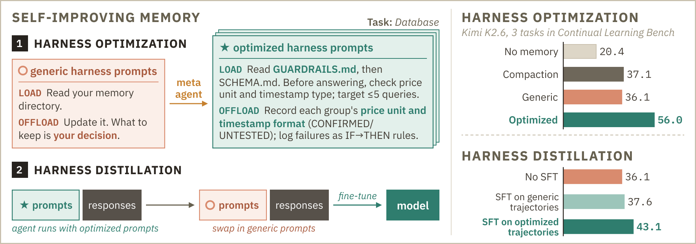
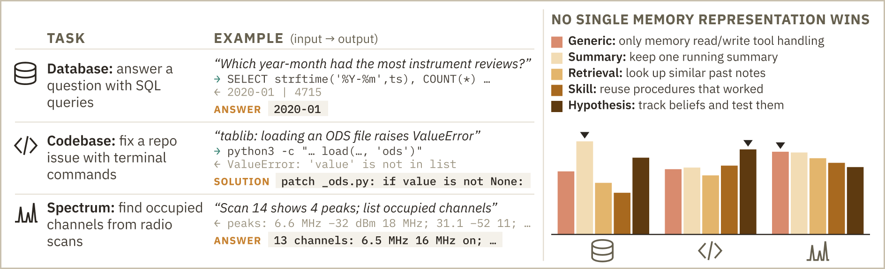
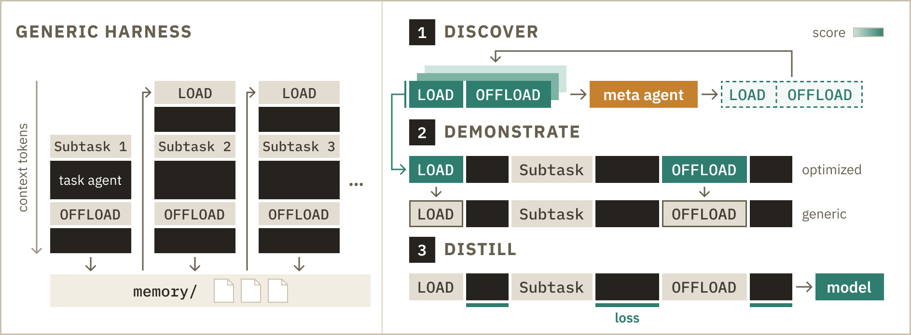
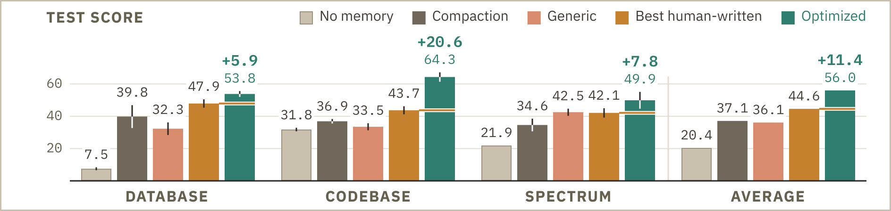
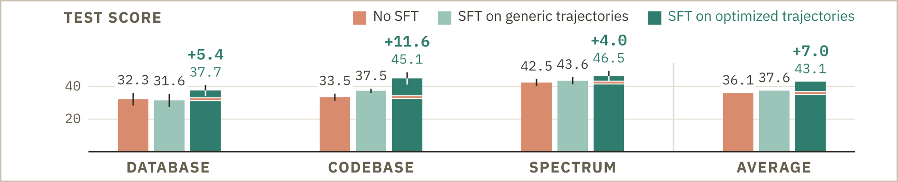
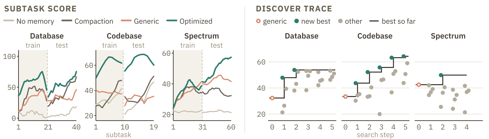
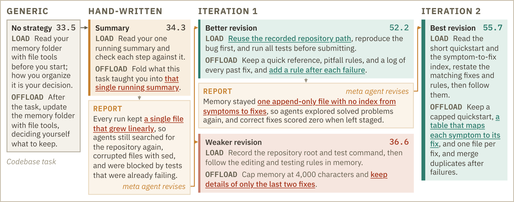

<script>
MathJax = {
  tex: {
    inlineMath: [['$', '$'], ['\\(', '\\)']],
    displayMath: [['$$', '$$'], ['\\[', '\\]']]
  }
};
</script>
<script src="https://cdn.jsdelivr.net/npm/mathjax@3/es5/tex-mml-chtml.js"></script>

<style>
.sim-figure {
  overflow-x: auto;
  margin: 1rem auto;
  text-align: center;
  -webkit-overflow-scrolling: touch;
}

.sim-figure img {
  display: block;
  width: var(--figure-width, 100%);
  max-width: 100%;
  height: auto;
  margin-inline: auto;
  cursor: zoom-in;
}

.sim-figure--pair {
  display: flex;
  gap: 2%;
  justify-content: flex-start;
}

.sim-figure--pair a {
  flex: 1 1 0;
}

.sim-figure--pair img {
  width: 100%;
}

.sim-figure-hint {
  display: none;
}

.sim-subtitle {
  margin-top: -0.75rem;
  color: #57606a;
  font-size: 1.3rem;
  line-height: 1.35;
}

@media (max-width: 700px) {
  .sim-figure img {
    width: var(--mobile-width, 760px);
    max-width: none;
    margin-inline: 0;
  }

  .sim-figure--pair img {
    width: 380px;
  }

  .sim-figure-hint {
    display: block;
    margin-top: -0.5rem;
    color: #57606a;
    font-size: 0.85rem;
  }
}
</style>

# Self-Improving Memory

<p class="sim-subtitle"><em>Meta-Optimization and Harness Distillation for Continual Learning Agents</em></p>

<a id="fig-teaser"></a>

<div class="sim-figure" style="--figure-width: 100%; --mobile-width: 900px;">
  <a href="fig1_teaser.png"></a>
</div>

<p class="sim-figure-hint">Swipe to explore the figure, or tap to open it at full size.</p>

_Figure 1. **A model (Kimi-K2.6) teaches itself better memory capabilities.** It first rewrites its own memory prompts for each task, keeping the versions that score best (harness optimization). It then runs with those prompts, swaps them back to generic ones in the recorded runs, and is fine-tuned on the result, so part of what the prompts taught moves into its weights (harness distillation). On three Continual Learning Bench tasks, its optimized prompts beat the best hand-written ones (56.0 vs 44.6). After fine-tuning, it scores 43.1 with only generic prompts, compared with 37.6 when trained on its generic-prompt runs._

## Overview

We want language models that get better at a task the longer they work on it.
For an agent, this means managing memory well: what to write down, how to organize it, and when to read it back.
Today these choices come from hand-written prompts, and no single prompt works best on every task.
Self-Improving Memory lets the model discover these choices itself and then trains them into its weights.
On three tasks from Continual Learning Bench, the prompts it discovers beat the best hand-written ones by 11.4 points (56.0 vs 44.6), and fine-tuning on runs with them gains 5.5 points over fine-tuning on the model's own generic runs (43.1 vs 37.6).

Self-Improving Memory works in two stages.
In harness optimization, a meta agent reads the task agent's trajectories, finds where its memory use falls short, and rewrites the prompts that tell it how to use memory. Each new prompt is evaluated, and the best ones are kept for further revision.
In harness distillation, the task agent runs with the optimized prompts, we swap those prompts back to generic ones while keeping the agent's responses, and we fine-tune the model on the result.
The meta agent and the task agent use the same model (Kimi-K2.6), so the model is trained on memory skills it discovered itself.
Training carries part of the gain from better prompts into the model's weights.


## Motivation: Memory skills should be learned

**Agents can improve with experience.**
An agent that works on multiple related tasks can pick up reusable knowledge from earlier tasks and apply it to later ones.
Persistent memory makes this possible by letting information pass beyond the boundary of a single task.
In our setting, every subtask starts in a fresh session with an empty context, and the only thing that carries over is a persistent memory directory that the agent reads and writes with file tools.

**No single memory design wins on every task.**
Throughout this post, we use Continual Learning Bench as our evaluation framework, focusing on three of its tasks: Database, Codebase, and Spectrum.
To motivate our approach, we conduct a small pilot study of several common, human-designed memory strategies.
Each strategy is implemented through two prompts: one (OFFLOAD) that instructs the agent to offload what it has learned after completing a subtask (a process sometimes called dreaming), and another (LOAD) that instructs it to load relevant information before the next subtask.
As Figure 2 shows, no single strategy performs best across all three tasks, consistent with the findings of Continual Learning Bench.

**So the model should learn its own memory design.**
Rather than following a hand-written design, it should decide what to write, how to organize it, and what to recall.
Self-Improving Memory does this in two stages, harness optimization and harness distillation, which we describe next.

<a id="fig-tasks-vs-harness"></a>

<div class="sim-figure" style="--figure-width: 100%; --mobile-width: 900px;">
  <a href="fig2_tasks_vs_harness.png"></a>
</div>

<p class="sim-figure-hint">Swipe to explore the figure, or tap to open it at full size.</p>

_Figure 2. **No single memory representation wins every task.** Left: the three tasks, each with an example subtask (input, tool calls, answer). Right: test scores of the generic harness and four hand-written harnesses that differ only in their memory instructions. ▼ marks the best per task._

## Method: Self-Improving Memory

Our goal is to optimize a task model's weights for continual learning tasks under a fixed generic harness.
To achieve this, we propose Self-Improving Memory, which follows a Discover-Demonstrate-Distill pipeline: a meta agent first discovers memory-management skills through harness optimization, the task agent then generates trajectories that demonstrate these skills, and finally we distill the demonstrated skills into model weights.
Because the meta agent and the task agent use the same model, this process updates the task model's weights to internalize skills discovered by the model itself.

### Setup: The generic harness

A *task agent* consists of a task model and a harness.
We use a file system as persistent memory in our *generic harness*.
The memory directory starts empty and persists throughout the task stream.
The harness provides file-reading, writing, and editing tools, along with two task-independent instructions: LOAD and OFFLOAD.
After each subtask is completed, an OFFLOAD prompt instructs the model to update its persistent memory based on the completed task interaction.
The live context is then cleared.
Before the next subtask begins, a LOAD prompt allows the model to load and retrieve relevant information from memory.
The model may read memory files immediately at the start of a subtask (e.g., README.md) or defer doing so until later in the problem-solving process.

In the generic harness, the LOAD and OFFLOAD instructions are deliberately concise: they simply direct the model to manage its memory through file-tool calls while leaving the specific strategy to the model itself.
However, performance may improve when these prompts prescribe a more specific, task-appropriate strategy. We explore how to discover such strategies in the next subsection.

<!-- As shown in Figure 3 (left), files rather than a summary in the live context carry information across the subtask boundary. -->

<a id="fig-method"></a>

<div class="sim-figure" style="--figure-width: 100%; --mobile-width: 900px;">
  <a href="fig3_method.png"></a>
</div>

<p class="sim-figure-hint">Swipe to explore the figure, or tap to open it at full size.</p>

_Figure 3. **The generic harness and the two stages.** Left: before and after each subtask, LOAD and OFFLOAD prompts make the task agent read and update a memory directory. The context is then cleared, so only the memory files carry over. Right: (1) a meta agent revises the prompts from trajectories and scores. (2a) The agent runs with the optimized prompts, which we then replace with the generic ones so that in (2b) we can fine-tune on these trajectories, with the loss on the model's outputs (dark blocks)._

### Harness Optimization

Using persistent memory effectively requires deciding what information to retain, how to organize it, and when to retrieve it. Rather than requiring the task model to make all of these decisions independently, the LOAD and OFFLOAD prompts can provide explicit strategies. For example, they can specify when the agent should access memory or how it should organize information into tables, skill libraries, or entity inventories.

We propose a harness-optimization procedure that automatically discovers task-specific memory-management strategies.
Our meta-optimization loop analyzes task-agent trajectories and compares alternative memory designs to identify LOAD and OFFLOAD instructions that maximize the task agent's mean score (on a holdout set different from the train split that the meta agent can see).

The meta-optimization loop consists of a *meta agent*, which analyzes trajectories and task scores from the train subtasks to propose revised harness instructions, and an *outer loop*, which evaluates the resulting harnesses and uses the resulting task scores to select promising designs for further revision.
We implement this search as follows:

- **Initialize the pool.** We start with S human-written harnesses (i.e., pairs of LOAD and OFFLOAD prompts) representing summary, retrieval, skill-library, and hypothesis-tracking memory designs.
- **Evaluate the harnesses.** For each unevaluated candidate, the task agent executes the full task stream N (e.g., 5) times, producing trajectories, subtask scores, and memory directories.
- **Select promising designs.** We rank the pool by mean task score across the N runs and select the top P (e.g., 4) harnesses as parents for revision.
- **Analyze experience and propose new designs.** For each parent, a meta agent analyzes the task agent's message histories, subtask scores, and final memory directories from the training split. It identifies recurring failures and proposes revisions to the harness instructions. To handle the length and volume of the trajectories, the meta agent first summarizes each subtask, then analyzes each complete run, and finally consolidates evidence across runs into revised LOAD and OFFLOAD instructions. The revised harness from each parent is added to the pool as a new candidate for evaluation.

We repeat this procedure for a given number of iterations and select the highest-ranking surviving harness.

### Harness Distillation

**Demonstrate.**
We turn the discovered memory-management and task-solving behaviors into training demonstrations under the generic harness.
For each task, we select the harness with the highest mean task score and run the base task model under this optimized harness on the train subtasks.
We log every language model call, including its prompt, response, reasoning content, tool calls and arguments, and the corresponding tool responses.
We then replace the optimized LOAD and OFFLOAD instructions wherever they appear in the recorded history with their generic counterparts.
This replacement works because the demonstrated behavior stays compatible with the generic instructions: the optimized harness specifies a memory design, while the generic harness leaves those choices to the model.
For example, compatible behaviors include *organizing memory files* (`QUICKSTART.md` for repository metadata, `REGISTRY.md` for reusable fixes, and `SCHEMA.md` for schema facts), *recording useful facts* (table relationships, column types, price units, timestamp encodings, and test commands), and *reusing problem-solving strategies* (running tests before editing, checking analogous functions, and verifying join keys before aggregation).

**Distill.**
For $K$ tasks, let $\mathcal D_k$ denote the transformed demonstrations from the train subtasks of task $k$.
We pool these demonstrations across tasks into a single dataset, reserving a validation split to monitor training.
Each demonstration $\tau$ is represented as a token sequence $x^\tau$, with generic instructions and interaction history providing context.

We finetune model weights $\theta$ by minimizing the masked next-token prediction loss:

$$
\mathcal L(\theta)
= -\frac{1}{K}\sum_{k=1}^{K}
  \frac{1}{N_k}\sum_{\tau\in\mathcal D_k}
  \sum_{i\in A_\tau}
  \log p_\theta(x_i^\tau\mid x_{\lt i}^\tau).
$$

Here $A_\tau$ indexes assistant tokens, including reasoning and tool calls, while instructions, task requests, and tool responses provide context and are masked from the loss.
The count $N_k=\sum_{\tau\in\mathcal D_k}|A_\tau|$ is the number of supervised tokens for task $k$. Normalization by $N_k$ and averaging over $K$ tasks give each task equal weight.
This objective trains the model to internalize the demonstrated capabilities in its weights and reproduce them under generic memory instructions.


## Results

We use Kimi-K2.6 as both the task agent and the meta agent. Harness optimization begins with four human-written seed harnesses—Summary, Retrieval, Skill, and Hypothesis. We evaluate each harness over five repeated runs and select the top four harnesses for revision in each iteration. For harness distillation, we use LoRA with rank 64, applied to the attention projection layers. We use the first part of each Continual Learning Bench task stream as train subtasks and the later part as test subtasks. The split falls at a phase transition designed into Continual Learning Bench, so test results reflect generalization to new instances within the same task.

We compare four baseline settings during harness optimization. **No Memory** clears the base model's context at each subtask boundary without retaining either a summary or a memory directory. Consequently, no information is carried across subtasks. **Summary-Based Compaction** summarizes the model's context at each boundary and passes the resulting summary to the next subtask. Under the **Generic** harness, the model follows the task-independent LOAD and OFFLOAD instructions defined above, with files carrying information across subtask boundaries. Finally, the **Human-Written** harnesses are the seed harnesses evaluated in the first optimization iteration.

For harness distillation, we compare supervised fine-tuning (SFT) on two trajectory sets: **SFT on Generic Trajectories**, collected using the generic harness, and **SFT on Optimized Trajectories**, collected using the optimized harness. To train the Self-Improving Memory model, we rewrite the optimized-harness trajectories using the generic instructions. Both fine-tuned models and the **No SFT** reference model use the same harness during evaluation.

### Automatic harness optimization delivers substantial gains

We select the best observed optimized harness separately for each task.
Averaging the three selected task scores gives a mean of 56.0, an improvement of 11.4 points over the human-written seeds selected for each task and 19.9 points over Generic (Figure 4).
The optimized harnesses improve over the selected human-written seeds on all three tasks, with the largest gain on Codebase (20.6 points).
On Spectrum, Generic and Optimized have nearly the same raw first-subtask score (21.7 and 21.9), but reach test means of 42.5 and 49.9 as experience accumulates (Figure 6a).
Both the human-written seeds and optimized harnesses are selected by task score, so these are the best observed scores among evaluated candidates.

<a id="fig-harness-results"></a>

<div class="sim-figure" style="--figure-width: 100%; --mobile-width: 900px;">
  <a href="fig4_harness_results.png"></a>
</div>

<p class="sim-figure-hint">Swipe to explore the figure, or tap to open it at full size.</p>

_Figure 4. **Optimized harnesses beat the best hand-written harness on every task.** Error bars show 95% CIs. Best human-written is the best of the four hand-written harnesses for each task, and +N is the Optimized gain over it._

### Training internalizes part of these gains

We finetune on demonstrations from train subtasks and evaluate generalization to test subtasks of the same tasks after domain shifts.
Across ten matched evaluation seeds, Harness Distillation reaches an overall mean test score of 43.1 versus 37.6 for SFT on generic trajectories, a gain of 5.5 points (14.6%, Figure 5).
Its 7.0-point gain over No SFT (36.1, the same reference evaluation as Generic in Figure 4) is descriptive because the base model was evaluated separately.
The improved test scores show that the finetuned model generalizes within the same tasks under domain shift, using generic memory instructions.
We hypothesize that the gain partly reflects improved memory organization and retrieval, alongside task-solving behavior, but isolating this mechanism requires direct behavioral analysis.

<a id="fig-distillation-results"></a>

<div class="sim-figure" style="--figure-width: 100%; --mobile-width: 900px;">
  <a href="fig5_distillation.png"></a>
</div>

<p class="sim-figure-hint">Swipe to explore the figure, or tap to open it at full size.</p>

_Figure 5. **Harness distillation moves part of the gain into the model's weights.** All models run with the generic harness. SFT on generic trajectories trains on generic-harness runs, and SFT on optimized trajectories trains on optimized-harness runs with the prompts swapped back to generic. Error bars show 95% CIs, and +N is the gain over No SFT._

### Meta-optimization requires evaluation and selection

Across the completed searches (Figure 6b), 37 of 44 generated revisions fail to beat the best score from previous iterations.
Database and Spectrum reach 53.8 and 49.9 in the first search generation and make no further gains, while Codebase improves through the fourth generation to 64.3.
Progress therefore depends on evaluating proposals and retaining the best observed designs.

<a id="fig-learning-search"></a>

<div class="sim-figure" style="--figure-width: 100%; --mobile-width: 900px;">
  <a href="fig6_learning_and_search.png"></a>
</div>

<p class="sim-figure-hint">Swipe to explore the figure, or tap to open it at full size.</p>

_Figure 6. **Learning across subtasks, and search progress.** Left: subtask scores for the runs in Figure 4, where the dashed line marks the train/test environment shift. Right: each dot is one evaluated harness (iteration 0: Generic, iteration 1: hand-written seeds, iterations 2 and later: harnesses proposed by the meta agent). The line tracks the best score so far._

### Case Study of Meta-Optimization

Figure 7 illustrates how trajectory reports guide revisions of the Codebase memory harness.
The Summary harness scores 34.3, barely above Generic at 33.5 and well below the best seed at 43.7. Its report identifies growing monolithic notes and repeated repository discovery.
A revision that reuses recorded paths and retains failure rules scores 52.2.
The next report diagnoses an append-only file without an index mapping symptoms to fixes, and a revision with a compact quickstart, an indexed registry, and separate fix files scores 55.7.
An alternative Summary revision that retains details of only the last two fixes scores 36.6.

<a id="fig-case-meta-optimization"></a>

<div class="sim-figure" style="--figure-width: 100%; --mobile-width: 900px;">
  <a href="fig7_case_study.png"></a>
</div>

<p class="sim-figure-hint">Swipe to explore the figure, or tap to open it at full size.</p>

_Figure 7. **How the meta agent revises the Codebase harness.** Each box shows a harness's LOAD and OFFLOAD prompts and test score. Each report diagnoses that harness's trajectories and motivates the next revision. Underlines mark the key changes._

## Conclusion

We present Self-Improving Memory, which improves a model's memory-management performance by training it on better memory-management trajectories.
We achieve this with a Discover-Demonstrate-Distill pipeline: the model discovers memory instructions tailored to each task, demonstrates them in its own trajectories, and is finetuned on those demonstrations so that it manages memory under a single generic harness.
We observe that automatically optimized harnesses outperform human-written ones (56.0 versus 44.6 for the best human-written seed and 36.1 for Generic), and that distillation carries part of these gains into the model weights (43.1 versus 37.6 for training on generic-harness trajectories).
We hope future work scales this approach to more agent capabilities beyond memory and to a wider range of tasks and models.

<details markdown="1">
<summary>See related work</summary>

## Related Work

**Meta-harness optimization.**
An agent's performance depends on its harness as well as its weights, yet harnesses are still largely designed by hand ([Lee et al., 2026](https://arxiv.org/abs/2603.28052)).
Early work used language models to optimize prompts from feedback, by searching over candidate instructions or evolving populations of prompts ([Zhou et al., 2022](https://arxiv.org/abs/2211.01910); [Yang et al., 2023](https://arxiv.org/abs/2309.03409); [Fernando et al., 2023](https://arxiv.org/abs/2309.16797); [Agrawal et al., 2025](https://arxiv.org/abs/2507.19457)).
Later methods search over entire agent designs or let agents rewrite their own code ([Hu et al., 2024](https://arxiv.org/abs/2408.08435); [Zhang et al., 2024](https://arxiv.org/abs/2410.10762); [Zhang et al., 2025](https://arxiv.org/abs/2505.22954)).
Recent systems optimize the harness itself, including coding-agent scaffolds, evolving playbooks, and skill harnesses ([Lee et al., 2026](https://arxiv.org/abs/2603.28052); [Lin et al., 2026](https://arxiv.org/abs/2604.25850); [Zhang et al., 2025](https://arxiv.org/abs/2510.04618); [Wei et al., 2026](https://arxiv.org/abs/2608.15071)), and ALMA and MemEvolve apply this search to memory designs ([Xiong et al., 2026](https://arxiv.org/abs/2602.07755); [Zhang et al., 2025](https://arxiv.org/abs/2512.18746)).
The gains of an optimized harness, however, remain tied to that harness at deployment.
Context distillation moves behavior induced by a prompt into the weights ([Snell et al., 2022](https://arxiv.org/abs/2209.15189); [Bhargava et al., 2024](https://arxiv.org/abs/2409.13697); [Ye et al., 2026](https://arxiv.org/abs/2602.12275)).
WHALE and Co-Harness alternate harness search with fine-tuning ([Kim et al., 2026](https://arxiv.org/abs/2609.00196); [Chen et al., 2026](https://arxiv.org/abs/2607.22688)), and Harness-Zero distills an optimized harness into a model that runs under a fixed one, using a separate agent to correct the student's actions ([Ye et al., 2026](https://arxiv.org/abs/2609.24974)).
Self-Improving Memory searches only the instructions that govern how the agent manages a memory directory across tasks.
Because the optimized and generic harnesses differ only in these instructions, we distill by swapping the generic prompts back into the recorded trajectories, with no correction step.
And because the meta agent and the task agent are the same model, the model learns memory skills that it discovered itself.

**Memory and continual learning agents.**
Continual learning classically studies how a model improves over a sequence of tasks by updating its weights without forgetting earlier ones ([Kirkpatrick et al., 2017](https://arxiv.org/abs/1612.00796); [Parisi et al., 2019](https://arxiv.org/abs/1802.07569)).
Benchmarks for language agents recast this goal as using experience from earlier tasks to do better on later ones ([Wu et al., 2024](https://arxiv.org/abs/2406.08747); [Zheng et al., 2025](https://arxiv.org/abs/2505.11942); [Wei et al., 2025](https://arxiv.org/abs/2511.20857)).
On Continual Learning Bench, which we use, agents often fail to reuse knowledge across instances, and dedicated memory systems do not fix this ([Asawa et al., 2026](https://arxiv.org/abs/2606.05661)).
Memory systems either store records in an external database ([Park et al., 2023](https://arxiv.org/abs/2304.03442); [Packer et al., 2023](https://arxiv.org/abs/2310.08560); [Xu et al., 2025](https://arxiv.org/abs/2502.12110); [Chhikara et al., 2025](https://arxiv.org/abs/2504.19413)) or write experience as text, such as reflections, skills, insights, workflows, and reasoning strategies ([Shinn et al., 2023](https://arxiv.org/abs/2303.11366); [Wang et al., 2023](https://arxiv.org/abs/2305.16291); [Zhao et al., 2023](https://arxiv.org/abs/2308.10144); [Wang et al., 2024](https://arxiv.org/abs/2409.07429); [Suzgun et al., 2025](https://arxiv.org/abs/2504.07952); [Ouyang et al., 2025](https://arxiv.org/abs/2509.25140)).
Deployed agents increasingly keep this memory as a directory of Markdown files that they edit with ordinary file tools ([Zhou et al., 2026](https://arxiv.org/abs/2607.26637)).
In all of these systems, a human decides what to store and how to organize it.
Yet no single memory-extraction prompt works best across task types ([Yang et al., 2026](https://arxiv.org/abs/2604.11610)), and memory that a language model keeps rewriting can become less useful than no memory at all ([Zhang et al., 2026](https://arxiv.org/abs/2605.12978)).
Reinforcement learning can train memory managers, but mostly for question answering or within a single long task ([Yan et al., 2025](https://arxiv.org/abs/2508.19828); [Wang et al., 2025](https://arxiv.org/abs/2509.25911); [Zhou et al., 2025](https://arxiv.org/abs/2506.15841)), while Auto-Dreamer learns to consolidate memory offline across related tasks ([Ye et al., 2026](https://arxiv.org/abs/2605.20616)).
Self-Improving Memory instead discovers the memory policy for each task, searching over LOAD and OFFLOAD instructions from four classic designs, and then distills that policy into the model's weights so that generic prompts suffice at deployment.

</details>

## Contributors
Tong Chen, Chuanyang Jin, Eryk Helenowski, Weizhe Yuan, Jason Weston, Ilia Kulikov, Xian Li, Swarnadeep Saha

## Citation
To reference the work in this blog post, please use the following BibTex entry:

```bibtex
@online{chen2026selfimprovingmemory,
  title  = {Self-Improving Memory: Meta-Optimization and Harness Distillation for Continual Learning Agents},
  author = {Tong Chen and Chuanyang Jin and Eryk Helenowski and Weizhe Yuan and Jason Weston and Ilia Kulikov and Xian Li and Swarnadeep Saha},
  year   = {2026},
  url    = {https://facebookresearch.github.io/RAM/blogs/self_improving_memory/}
}
```
