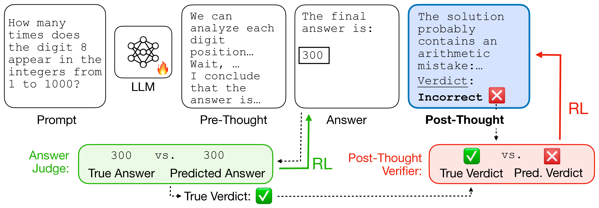
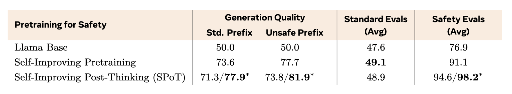
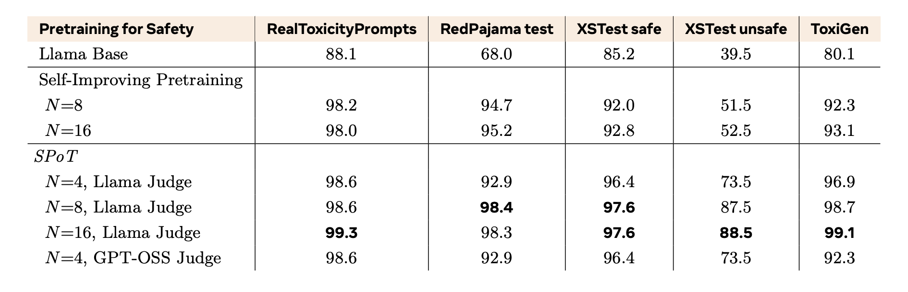
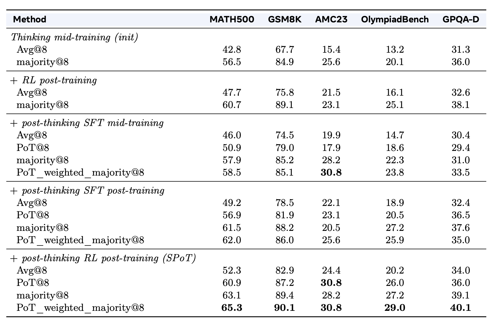
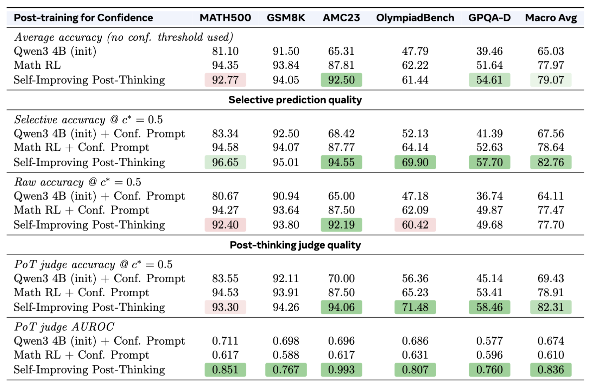
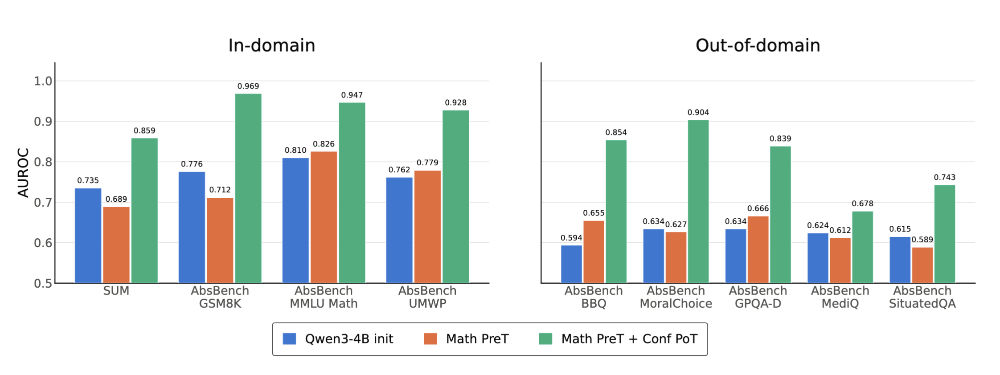

<script>
MathJax = {
  tex: {
    inlineMath: [['$', '$'], ['\\(', '\\)']],
    displayMath: [['$$', '$$'], ['\\[', '\\]']]
  }
};
</script>
<script src="https://cdn.jsdelivr.net/npm/mathjax@3/es5/tex-mml-chtml.js"></script>

<style>
.sip-figure {
  overflow-x: auto;
  margin: 1rem auto;
  text-align: center;
  -webkit-overflow-scrolling: touch;
}

.sip-figure img {
  display: block;
  width: var(--figure-width, 100%);
  max-width: 100%;
  height: auto;
  margin-inline: auto;
  cursor: zoom-in;
}

.sip-table-wrap {
  overflow-x: auto;
  margin: 1rem 0;
  -webkit-overflow-scrolling: touch;
}

.sip-table-wrap table {
  min-width: 620px;
  margin: 0 auto;
}

.sip-figure-hint {
  display: none;
}

@media (max-width: 700px) {
  .sip-figure img {
    width: var(--mobile-width, 760px);
    max-width: none;
    margin-inline: 0;
  }

  .sip-figure-hint {
    display: block;
    margin-top: -0.5rem;
    color: #57606a;
    font-size: 0.85rem;
  }
}
</style>

# Self-Improving Post-Thinking


Large language models routinely produce generations with unsafe outputs, flawed reasoning and overconfident mistakes. In this work, we argue that a crucial missing ingredient in LLMs is a built-in self-judging ability. We show that we can train models for self-judging, and obtain
models with the ability to judge their own generations and to know when they are likely to
be wrong. 

We thus introduce **Self-Improving Post-Thinking**: after generating a response, the model
emits a critical chain-of-thought and a verdict over its own just-generated text, allowing it to
judge the generation along any axis of interest. 


<div class="sip-figure" style="--figure-width: 97%; --mobile-width: 900px;">
  <a href="post_thinking.png"></a>
</div>

<p class="sip-figure-hint">Swipe to explore the figure; tap to open it at full size.</p>

*Figure 1. **Self-Improving Post-Thinking.** Given an input, the model generates both standard chain-of-thought
reasoning (i.e., pre-thinking) followed by its response (answer), and then post-thinking reasoning that self-judges its own
generation. Post-thinking judgments are then used to (i) steer toward aligned, calibrated and high quality answers;
and (ii) distill self-evaluation abilities to the policy through fine-tuning. The model can learn all these abilities (pre-,
answer, and post-thoughts) simultaneously through reinforcement learning.*


We apply post-thinking to continual pretraining, mid-training and post-training, teaching models to produce post-thoughts 
that assess their own safety, correctness, and confidence, while also improving the generations themselves.

Continual pretraining with post-thinking improves safety by 21.3% on average across five safety benchmarks over the same model without
post-thoughts, at no cost to generation quality. Mid-training and post-training with post-thinking
improve mathematical reasoning across four benchmarks over post-training without post-thinking,
so learning to judge also makes the model a better solver. Using those post-thoughts at inference
to select among solutions brings further gains. 

Finally, when applied to confidence estimation,
post-thinking improves models' calibration and provides meaningful signal for selective prediction,
e.g. improving selective accuracy by +5pp on average on out-of-distribution benchmarks while
providing 90% coverage. These results show we can direct models' reasoning capabilities into
self-judging which translates to safer, more accurate and reliable generations at inference time.

## Post-Thinking

**Post-thinking** is a reasoning phase generated after the answer allowing the model to be critical and "self-aware" of the quality of its own generations. 
In this setting, a complete generation has the form

$$
[\langle\text{pre}\rangle,\ \tau,\ \langle/\text{pre}\rangle,\ \bar{x},\ \langle\text{post}\rangle,\ \psi,\ \langle/\text{post}\rangle],
$$

where $\tau$ is the usual chain-of-thought reasoning trace (which we call pre-thinking as it occurs before the answer), $\bar{x}$ is the answer, and $\psi$ is a critical assessment, which we call post-thinking, that occurs *after* the answer and ends in a structured verdict — for example, *Safe* or *Unsafe*, *Correct* or *Incorrect*, or a confidence value between 0 and 1.

We train this model in combination with other recently introduced learning methods, and call the resulting training 
recipe **Self-Improving Post-Thinking (SPoT)**. 
It can be introduced during continual pretraining, mid-training, or during post-training.

## How Self-Improving Post-Thinking is trained

We consider several settings.

### Non-verifiable setting with strong teacher

In a non-verifiable setting when a strong teacher judge is available, it produces a target post-thought $\psi^*$ that explains and labels the quality of a policy continuation. We jointly optimize the continuation and the judgment:

$$
\mathcal{L}_{\text{total}} = \mathcal{L}_{\text{RL}}(\bar{x}) + \omega_\psi\mathcal{L}_{\text{SFT}}(\psi^*)
$$

The RL term improves what the policy generates (in our experiments we use online DPO, which trains on chosen/rejected pairs of continuations); the SFT term distills the teacher's evaluation process into the policy. Importantly, judgment labels must be balanced. For example, for safety verdicts, as generations improve, most rollouts may become safe or correct. Training indiscriminately on that stream can collapse the self-judge into always predicting the majority label. We therefore supervise post-thinking only on pairs with contrasting verdicts, which we find fixes the issue.

### Verifiable setting

In domains with rule-verifiable answers, the teacher can be removed (perhaps after an SFT stage). 
The policy samples post-thoughts, and each one receives a verdict-match reward based on the known correctness $r$ of the answer it just judged:

$$
R_{\text{match}} =
\begin{cases}
1 & \text{if the verdict agrees with } r, \\
0 & \text{if the verdict is well formed but disagrees}, \\
-\epsilon & \text{if no well-formed verdict is produced},
\end{cases}
$$

where the small penalty $\epsilon$ (we use 0.1) keeps the policy from avoiding a decision. The answer keeps its usual correctness reward, so both the generation and the judgment are now improved with reinforcement learning:

$$\mathcal{L}_{\text{total}} = \mathcal{L}_{\text{RL}}(\tau, \bar{x}) + \omega_\psi\mathcal{L}_{\text{RL}}(\psi)$$

## Experiments

### Safety: a policy learns to police its own generations

We first combine post-thinking with continual pretraining for safety. A Llama 1.4B policy learns to generate a safety judgment after each continuation while it simultaneously learns to generate safer text. For policy training we use the [self-improving pretraining](https://arxiv.org/abs/2601.21343) (SIP) technique whereby a strong judge is used to reinforcement-learn the text continuations for safety and quality -- which already substantially outperforms next-token prediction.


We find that the post-thinking objective improves the continuation over the baselines, even before its verdict is used: greedy safety rises from 91.1% for Self-Improving Pretraining to 94.6% with SPoT. At inference time, the policy can sample several candidates and use its own post-thoughts to select among them (PoT@8 when choosing among eight candidates), further raising average safety to **98.2%**. This is within 1.2 points of selection by the external GPT-OSS-120B "oracle" used to measure safety in our experiments, despite the policy being roughly 86 times smaller.


<div class="sip-figure" style="--figure-width: 87%; --mobile-width: 900px;">
  <a href="safety_fig.png"></a>
</div>

<p class="sip-figure-hint">Swipe to explore the figure; tap to open it at full size.</p>

*Table 1. **Self-Improving Post-Thinking (SPoT) improves safety at little cost to standard capability or generation quality**, compared
to standard next-token pretraining (Llama Base 1.4B) and the Self-Improving Pretraining (SIP) baseline.
Baseline rows report greedy safety rates; Self-Improving Post-Thinking row (SPoT) reports both
greedy and PoT@8 results, the latter is the rollout selected by the policy's own post-thought verdict  (marked with an asterisk).*

The policy learns this skill quickly: with sixteen training-time rollouts, agreement between its post-thought and the stronger teacher reaches about 89% on chosen continuations after roughly 100 steps. More rollouts also help most on the hardest safety tasks. 


<div class="sip-figure" style="--figure-width: 87%; --mobile-width: 900px;">
  <a href="safety2_fig.png"></a>
</div>

<p class="sip-figure-hint">Swipe to explore the figure; tap to open it at full size.</p>

*Table 2. **Self-Improving Post-Thinking for safety varying the number of training-time rollouts and teacher judge.** 
Llama Base and SIP use the greedy continuation (the model emits no
post-thought verdict to select with), and SPoT uses PoT@8 — the rollout selected by the policy's own post-thought
verdict.*

### Reasoning: solving and checking improve together

Next, we combine post-thinking with training both pre-thinking and answering with RL at mid-training time, an extension of [Thinking Mid-training](https://facebookresearch.github.io/RAM/blogs/thinking_midtraining/). That method already uses RL to train reasoning before answering on pretraining documents; we teach it to also judge the correctness of its completed solution afterward. We consider three consecutive stages that differ in data and supervision:

1. **Post-thinking SFT during mid-training** trains Llama 3.1 8B and continues on the Thinking Mid-training corpus of web and math documents (DCLM and FineMath). A teacher judge (GPT-OSS-120B) rewards each continuation and supplies the target post-thought.
2. **Post-thinking SFT during post-training** switches to competition math problems (DAPO-Math-14k). A rule-based verifier (Math-Verify) now rewards each final answer, while the post-thought is still supervised by the teacher.
3. **Post-thinking RL during post-training** stays on the same math problems but removes the teacher: the post-thought is trained with the verdict-match reward above, scored against the verifier.

<!--
<div class="sip-figure" style="--figure-width: 100%; --mobile-width: 1000px;">
  <a href="reasoning_pipeline.png"></a>
</div>

<p class="sip-figure-hint">Swipe to explore the figure; tap to open it at full size.</p>

*Figure 3. **Three-stage training for reasoning.** Each row is one stage, initialized from the one above. Mid-training uses web and math documents (DCLM and FineMath) with GPT-OSS-120B as the judge; both post-training stages use DAPO-Math-14k, where Math-Verify checks the answer A′ against the reference A\*. The two SFT stages imitate the teacher's post-thought (PoT); the RL stage instead rewards the policy's own post-thought for agreeing with Math-Verify.*
-->


<div class="sip-figure" style="--figure-width: 87%; --mobile-width: 900px;">
  <a href="reasoning_fig.png"></a>
</div>

<p class="sip-figure-hint">Swipe to explore the figure; tap to open it at full size.</p>

*Table 3. **Reasoning Post-Thinking for Math and Science.** Each prompt is answered 8 times; Avg@8 averages
results, majority@8 takes the majority answer (after clustering by equivalence), PoT@8 picks the rollout the model's
own post-thinking self-judge scores highest, and PoT\_weighted\_majority@8 weights each cluster by its summed
self-judge score. The three post-thinking rows form a training pipeline, each initialized from the one above; + RL
post-training is a sibling branch off the same initialization (separate baseline). Neither of the first two rows has been
trained to post-think, so neither produces a usable verdict and their self-judge cells are left empty. Post-thinking
brings gains across all datasets and metrics.*


**Learning to judge makes the model a better solver.** We find that average accuracy (Avg@8) rises at every stage, from 34.8 to 45.0. For comparison, the same starting model post-trained with RL but without post-thinking reaches 40.3: SPoT is 4.7 points ahead before its verdict is used at all. 

<!--
<div class="sip-figure" style="--figure-width: 100%; --mobile-width: 1000px;">
  <a href="reasoning_training_dynamics.png"></a>
</div>

<p class="sip-figure-hint">Swipe to explore the figure; tap to open it at full size.</p>

*Figure 4. **Solving and checking are learned together.** Training dynamics across three consecutive stages, each initialized from the previous one. Blue tracks the continuation or answer reward; orange tracks post-thought loss in the SFT stages and verdict-match reward in the RL stage. For most of training, the solve side and self-judgment side improve together rather than trading off.*
-->

**Post-thought verdicts improve both answer selection and voting.** Picking the solution that the model's own post-thought rates highest (PoT@8) raises average accuracy from 45.0 to 51.2. That single self-selected answer already beats the baseline's majority vote over all eight samples, 49.5. Weighting the vote by post-thought verdicts gives the best result in the table, 53.8 against 52.0 for plain voting, and it beats plain voting on all five benchmarks we evaluate.

**The gain from self-selection grows at every stage, most under RL.** The margin of PoT@8 over Avg@8 grows from 2.8 points after the first stage to 3.4 after the second and 6.2 after the third. The largest jump comes from RL, where the verdict is rewarded for agreeing with a verifier instead of for imitating a teacher.

<!--
<div class="sip-table-wrap" markdown="1">

| Math reasoning | Avg@8 | PoT@8 | majority@8 | PoT\_weighted\_majority@8 |
|---|---:|---:|---:|---:|
| Thinking Mid-training (init) | 34.8 | — | 46.8 | — |
| + RL post-training | 40.3 | — | 49.5 | — |
| + post-thinking SFT mid-training | 38.8 | 41.6 | 48.4 | 49.6 |
| + post-thinking SFT post-training | 42.2 | 45.6 | 49.4 | 49.9 |
| + post-thinking RL post-training (SPoT) | **45.0** | **51.2** | **52.0** | **53.8** |

</div>

*Table 3. Post-thinking improves both solving and selection for Llama 3.1 8B after Thinking Mid-training, averaged over MATH-500, GSM8K, AMC23, and OlympiadBench with eight samples per problem. Avg@8 is the accuracy of a single sample; PoT@8 picks the sample the model's own post-thought rates highest; majority@8 and PoT\_weighted\_majority@8 vote over the eight answers, unweighted and weighted by post-thought verdicts. The three post-thinking rows form a chain, each initialized from the one above; “+ RL post-training” branches from the same initialization without post-thinking. Rows without post-thinking produce no verdict, so their PoT columns are empty.*
-->

### Confidence: the model learns to know when not to answer

A binary correct/incorrect judgment is useful, but many applications need calibrated confidence. We therefore train Qwen3 4B to emit a numeric confidence estimate after its solution. The solution receives the usual correctness reward, while the post-thought receives a reward based on the Brier score:

$$
R_{\text{conf}} = 1 - (\hat{c} - r)^2,
$$

where $\hat{c}$ is predicted confidence and $r$ is the answer's ground-truth correctness.

The resulting confidence enables **selective prediction**: accept an answer when confidence is above a chosen threshold and abstain otherwise. 
We compare to two baselines: (1) no confidence estimation at all (always predicting); and (2) prompted confidence elicitation over two forward passes. In the first pass, the model is instructed to produce a solution and a final answer. In the second pass, the same model is given the problem, its previously generated
solution and final answer, and is instructed to generate a judgment and a confidence. 


At a threshold of 0.5, confidence post-thinking improves macro-average selective accuracy from 67.56% (no confidence measure used) or 78.64% (prompted confidence) to **82.76%**, while maintaining comparable raw accuracy. It also improves self-judge AUROC from 0.610 to **0.836**.


<div class="sip-figure" style="--figure-width: 97%; --mobile-width: 900px;">
  <a href="conf_fig1.png"></a>
</div>

<p class="sip-figure-hint">Swipe to explore the figure; tap to open it at full size.</p>

*Table 4. **Self-Improving Post-Thinking improves confidence estimation and translates to improvements in selective accuracy.**
When abstaining on solution rollouts whose predicted confidence is below a threshold, across all metrics post-thinking
for confidence brings improvements in both accuracy and judge quality metrics.*


The confidence signal generalizes beyond the training setup. Although training uses answerable math problems, post-thinking becomes better at identifying unanswerable questions, including questions outside mathematics. The solve-time objective may still pressure the model to produce an answer, but the subsequent judgment can flag unsupported assumptions and assign low confidence.


<div class="sip-figure" style="--figure-width: 97%; --mobile-width: 900px;">
  <a href="conf2_fig.png"></a>
</div>

<p class="sip-figure-hint">Swipe to explore the figure; tap to open it at full size.</p>

*Figure 2. **Self-Improving Post-Thinking for confidence generalizes to abstention on unanswerable questions.** We report AUROC using predicted confidence values from each model as a signal to differentiate between (1) correct solutions for answerable problems, and (2) everything else (i.e., incorrect solutions for answerable problems or unanswerable problems). Post-thinking improves the AUROC for all benchmarks, although it was never explicitly trained to
detect unanswerable questions. Note that Math PreT (vanilla correctness RL) decreases AUROC compared to the initial checkpoint baseline on 2 out of 4 benchmarks.*


## Conclusion

We introduce Self-Improving Post-Thinking which teaches models to generate critical chain-of-thought *post-thinking* over the text they just generated. Thinking about generations after they are generated, trained jointly with the main generation objective, endows a model with judging abilities, in a way making them self-aware of their own failures and successes. 

We apply post-thinking to three domains: safety, reasoning and confidence judgment.
Across safety, reasoning and confidence applications, we observed the same high-level pattern: the post-thinking objective can give gains rather than costing generation quality or ability to solve problems -- and the post-thinking judgments are useful at inference time (e.g., for selecting the best rollout candidates or deciding to abstain in the confidence application).
When applied to confidence prediction, post-thinking judgments improve calibration and provide signal for meaningfully improving selective prediction, both at the solution level and problem level.

Together, our results support that teaching models pre-thinking and post-thinking during mid-training and post-training is a strong approach for improving generation quality, reasoning, and self-judgment.


## Contributors


Zichun Yu\*, Polina Kirichenko\*, Sainbayar Sukhbaatar, Jason Weston and Olga Golovneva.

\* Equal contribution.

## More details

See the [full technical report](https://arxiv.org/abs/2601.21343) Chapter 3 for complete experimental details. 

The companion [Thinking Mid-training blog](https://facebookresearch.github.io/RAM/blogs/thinking_midtraining/) covers the previous chapter.

## Citation

To reference this work, please use:

```bibtex
@misc{tan2026selfimprovingtrainingandthinking,
      title={Self-Improving Training \& Thinking},
      author={Ellen Xiaoqing Tan and Jack Lanchantin and Zichun Yu and Polina Kirichenko and Shehzaad Dhuliawala and Danwei Li and Thao Nguyen and Jing Xu and Ping Yu and Ilia Kulikov and Sainbayar Sukhbaatar and Jason Weston and Xian Li and Olga Golovneva},
      year={2026},
      eprint={2601.21343},
      archivePrefix={arXiv},
      primaryClass={cs.CL},
      url={https://arxiv.org/abs/2601.21343}
}
```
