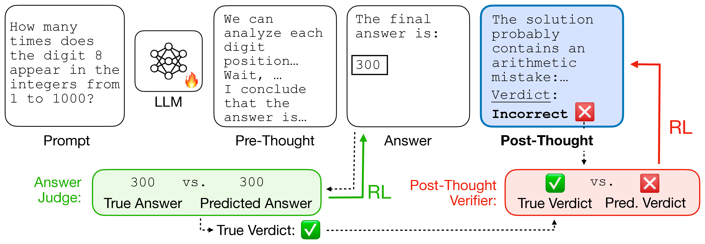
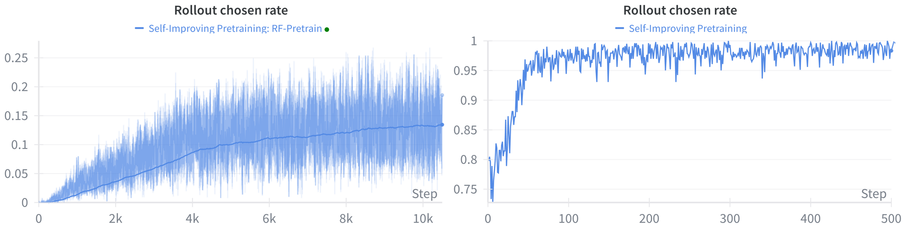
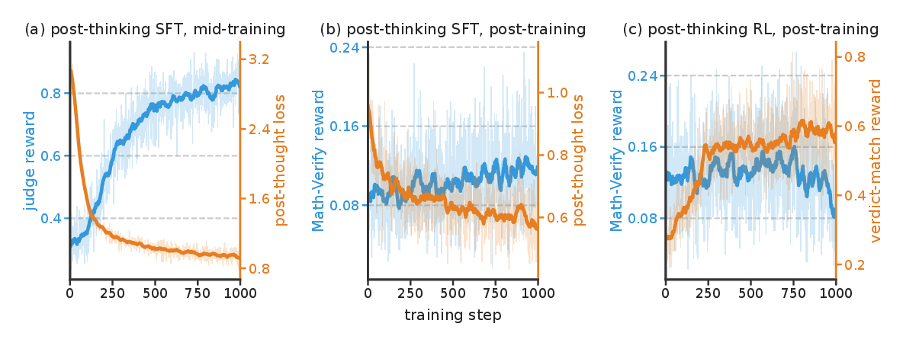

<script>
MathJax = {
  tex: {
    inlineMath: [['$', '$'], ['\\(', '\\)']],
    displayMath: [['$$', '$$'], ['\\[', '\\]']]
  }
};
</script>
<script src="https://cdn.jsdelivr.net/npm/mathjax@3/es5/tex-mml-chtml.js"></script>

<style>
.sip-figure {
  overflow-x: auto;
  margin: 1rem auto;
  text-align: center;
  -webkit-overflow-scrolling: touch;
}

.sip-figure img {
  display: block;
  width: var(--figure-width, 100%);
  max-width: 100%;
  height: auto;
  margin-inline: auto;
  cursor: zoom-in;
}

.sip-table-wrap {
  overflow-x: auto;
  margin: 1rem 0;
  -webkit-overflow-scrolling: touch;
}

.sip-table-wrap table {
  min-width: 620px;
  margin: 0 auto;
}

.sip-figure-hint {
  display: none;
}

@media (max-width: 700px) {
  .sip-figure img {
    width: var(--mobile-width, 760px);
    max-width: none;
    margin-inline: 0;
  }

  .sip-figure-hint {
    display: block;
    margin-top: -0.5rem;
    color: #57606a;
    font-size: 0.85rem;
  }
}
</style>

# Self-Improving Pretraining: Teaching Models to Generate—and Judge—Better Text

Large language models are usually trained in stages. First, pretraining teaches them to predict the next token from vast amounts of raw text. Only later does post-training teach desirable behaviors such as instruction following, safety, factuality, and reasoning. This separation has a weakness: post-training is asked to correct behaviors whose foundations were already established much earlier.

In [Self-Improving Pretraining](https://arxiv.org/abs/2601.21343), we ask a different question: **can a strong post-trained model help train the next model from the beginning?**

Our answer has three parts:

1. **Self-Improving Pretraining** uses a strong post-trained model to rewrite pretraining data and judge model-generated continuations, improving quality, factuality, and safety during pretraining itself.
2. **[Thinking Mid-training](https://facebookresearch.github.io/RAM/blogs/thinking_midtraining/)** inserts and optimizes reasoning before a continuation, teaching the model to plan before it answers.
3. **Self-Improving Post-Thinking** teaches the model to reason after its answer and judge its own generation for safety, correctness, or confidence.

This post focuses on improving a model's generations early, then teaching the model to evaluate those generations itself.

<div class="sip-figure" style="--figure-width: 97%; --mobile-width: 900px;">
  <a href="post_thinking.png"></a>
</div>

<p class="sip-figure-hint">Swipe to explore the figure; tap to open it at full size.</p>

*Figure 1 (Figure 13 in the paper). **Self-Improving Post-Thinking.** Given an input, the model first produces standard chain-of-thought reasoning (pre-thinking), then an answer, and finally post-thinking that judges the answer. The judgment can steer generation toward aligned, calibrated, high-quality answers and can be distilled back into the policy. All three abilities can be learned together with reinforcement learning.*

## Part I: Reinventing pretraining as sequence learning

Standard language-model pretraining rewards the exact next token found in the training corpus. But the text found on the web is not uniformly high quality, safe, or factual, and reproducing a flawed continuation exactly is not always what we want a deployed model to do.

We instead formulate pretraining as a **sequence-generation task**. We split streaming documents into a prefix and a suffix, then train the policy to generate a high-quality suffix of length $N$ conditioned on the prefix:

$$
\bar{x}_j \sim \pi(\cdot \mid x_{1,\ldots,j-1}).
$$

The original suffix remains useful as a reference, but it is no longer treated as the only acceptable target. This opens the door to training on improved targets and to comparing complete candidate generations along the properties we care about.

## A post-trained model becomes a rewriter and a judge

The key resource in our setup is an existing strong, post-trained model. It has already learned from both pretraining and post-training data, so we use that knowledge to provide a better signal to the next policy model in two roles.

**As a rewriter**, the teacher improves the original suffix. A quality rewrite can repair weak text; a safety rewrite can show how to steer away from an unsafe continuation while preserving the unsafe prefix as context; and other rewrites can introduce diversity, knowledge, or reasoning.

**As a judge**, the teacher scores several possible continuations:

- the original suffix from the pretraining document;
- a rewritten suffix from the teacher; and
- $K$ online rollouts from the current policy.

The policy then learns from the highest- and lowest-scoring candidates. We study reward-filtered negative log-likelihood and online DPO. Online DPO is particularly useful here because it can compare off-policy sequences - the original and rewritten suffixes - with fresh policy rollouts.

At the start of training, policy rollouts tend to be poor, so the original suffix and rewrite provide the strongest targets. Later, as the policy improves, the judge increasingly selects the policy's own generations. In this sense, the training signal becomes progressively more self-generated.

<div class="sip-figure" style="--figure-width: 100%; --mobile-width: 900px;">
  <a href="rollout_chosen_rate.png"></a>
</div>

<p class="sip-figure-hint">Swipe to explore the figure; tap to open it at full size.</p>

*Figure 2. **The policy's own generations become useful training targets.** Rollout chosen rate on the training data during from-scratch pretraining (left) and continual pretraining (right). Initially, policy rollouts receive low rewards and the original or rewritten suffix is chosen more often. As the policy improves, the judge increasingly rewards its high-quality rollouts.*

## Better generations from the ground up

We apply the method to three objectives: overall generation quality, factuality, and safety. Experiments cover both continual pretraining from a Llama 2 1.4B checkpoint and training the same architecture from scratch.

The headline result is that sequence-level reinforcement during pretraining improves the target behavior without sacrificing standard capabilities. In continual pretraining, the method reaches up to an **86.3% generation-quality win rate** over standard pretraining, alongside **36.2% relative improvement in factuality** and **18.5% relative improvement in safety**. In from-scratch training, it improves generation-quality win rate by 31.1 percentage points and safety by 14.4% relative.

<div class="sip-table-wrap" markdown="1">

| Pretraining objective | Baseline | Self-Improving Pretraining | What changes |
|---|---:|---:|---|
| Factuality, SlimPajama pointwise | 35.4 | **63.5** | +28.1 points |
| Factuality, FActScore pairwise | 48.9 | **69.3** | +20.4 points |
| Safety, RedPajama held-out | 67.4 | **93.4** | +26.0 points |
| Safety, ToxiGen | 82.0 | **93.1** | +11.1 points |

</div>

*Table 1. Selected continual-pretraining results. The factuality baseline is standard continued pretraining on SlimPajama; the safety baseline is standard continued pretraining on RedPajama. Full results and evaluation details are in Chapter 1 of the paper.*

The number of online rollouts matters. With more candidates, the judge has a better chance of finding a strong policy-generated continuation. In the safety setting, increasing from one to sixteen rollouts raises both generation quality and the average safety score. Rewrites are most useful early; multiple on-policy candidates become increasingly valuable as the model improves.

## Part II: From generating better text to judging it

Self-Improving Pretraining teaches a model to produce better continuations, and [Thinking Mid-training](https://facebookresearch.github.io/RAM/blogs/thinking_midtraining/) teaches it to reason before producing them. But one ability is still missing: after a model answers, can it recognize whether its answer is safe, correct, or trustworthy?

We introduce **post-thinking**, a critical reasoning phase generated after the answer. A complete generation has the form

$$
[\langle\text{pre}\rangle,\ \tau,\ \langle/\text{pre}\rangle,\ \bar{x},\ \langle\text{post}\rangle,\ \psi,\ \langle/\text{post}\rangle],
$$

where $\tau$ is the usual reasoning trace, $\bar{x}$ is the answer, and $\psi$ is a critical assessment ending in a structured verdict—for example, *Safe* or *Unsafe*, *Correct* or *Incorrect*, or a confidence value between 0 and 1.

We call the resulting training recipe **Self-Improving Post-Thinking (SPoT)**. It can be introduced during continual pretraining, composed with Thinking Mid-training, or added during post-training.

## How Self-Improving Post-Thinking is trained

When a strong teacher judge is available, it produces a target post-thought $\psi^*$ that explains and labels the quality of a policy continuation. We jointly optimize the continuation and the judgment:

$$
\mathcal{L}_{\text{total}}
= \mathcal{L}_{\text{DPO}}(\bar{x})
+ \omega\mathcal{L}_{\text{SFT}}(\psi^*).
$$

The DPO term improves what the policy generates; the SFT term distills the teacher's evaluation process into the policy. Importantly, judgment labels must be balanced. As generations improve, most rollouts may become safe or correct. Training indiscriminately on that stream can collapse the self-judge into always predicting the majority label. We therefore supervise post-thinking only on pairs with contrasting verdicts.

In domains with rule-verifiable answers, the teacher can eventually be removed. The policy samples post-thoughts and receives a reward when its verdict matches the known correctness of the answer it just judged. This lets the model improve its self-judgment directly with reinforcement learning.

## Safety: a small policy learns to police its own generations

We first combine post-thinking with continual pretraining for safety. A 1.4B policy learns to generate a safety judgment after each continuation while it simultaneously learns to generate safer text.

The post-thinking objective improves the continuation itself even before its verdict is used: greedy safety rises from 91.1% for Self-Improving Pretraining to 94.6% with SPoT. At inference time, the policy can sample several candidates and use its own post-thoughts to select among them, raising average safety to **98.2%**. This is within 1.2 points of selection by the external GPT-OSS-120B oracle, despite the policy being roughly 86 times smaller.

<div class="sip-table-wrap" markdown="1">

| Safety pretraining | Generation quality, standard / unsafe prefix | Standard evals | Safety evals |
|---|---:|---:|---:|
| Llama Base | 50.0 / 50.0 | 47.6 | 76.9 |
| Self-Improving Pretraining | 73.6 / 77.7 | **49.1** | 91.1 |
| SPoT, greedy | 71.3 / 73.8 | 48.9 | 94.6 |
| SPoT, self-selected | **77.9 / 81.9** | — | **98.2** |

</div>

*Table 2. Post-thinking improves safety at little cost to standard capability or generation quality. “Self-selected” chooses among eight rollouts using the policy's own post-thought verdict.*

The policy learns this skill quickly: with sixteen training-time rollouts, agreement between its post-thought and the stronger teacher reaches about 89% on chosen continuations after roughly 100 steps. More rollouts also help most on the hardest safety split, XSTest-unsafe.

## Reasoning: solving and checking improve together

Next, we combine post-thinking with the model produced by [Thinking Mid-training](https://facebookresearch.github.io/RAM/blogs/thinking_midtraining/). That model already reasons before answering; we teach it to judge the correctness of its completed solution afterward. We train in three consecutive stages: post-thinking SFT during mid-training, post-thinking SFT during math post-training, and post-thinking RL whose verdict is checked by a rule-based verifier.

**Learning to judge makes the model a better solver.** Average accuracy (Avg@8) rises at every stage, from 34.8 to 45.0 (Table 3). The fair comparison is the same starting model post-trained with RL but without post-thinking, which reaches 40.3: SPoT is 4.7 points ahead before its verdict is used at all. The training curves in Figure 3 show the two sides improving together rather than trading off.

<div class="sip-figure" style="--figure-width: 100%; --mobile-width: 1000px;">
  <a href="reasoning_training_dynamics.png"></a>
</div>

<p class="sip-figure-hint">Swipe to explore the figure; tap to open it at full size.</p>

*Figure 3. **Solving and checking are learned together.** Training dynamics across three consecutive stages, each initialized from the previous one. Blue tracks the continuation or answer reward; orange tracks post-thought loss in the SFT stages and verdict-match reward in the RL stage. For most of training, the solve side and self-judgment side improve together rather than trading off.*

**Post-thought verdicts improve both answer selection and voting.** Picking the solution that the model's own post-thought rates highest (PoT@8) raises average accuracy from 45.0 to 51.2. That single self-selected answer already beats the baseline's majority vote over all eight samples, 49.5. Weighting the vote by post-thought verdicts gives the best result in the table, 53.8 against 52.0 for plain voting, and it beats plain voting on all five benchmarks we evaluate.

**The gain from self-selection grows at every stage, most under RL.** The margin of PoT@8 over Avg@8 grows from 2.8 points after the first stage to 3.4 after the second and 6.2 after the third. The largest jump comes from RL, where the verdict is rewarded for agreeing with a verifier instead of for imitating a teacher.

<div class="sip-table-wrap" markdown="1">

| Math reasoning | Avg@8 | PoT@8 | majority@8 | PoT\_weighted\_majority@8 |
|---|---:|---:|---:|---:|
| Thinking Mid-training (init) | 34.8 | — | 46.8 | — |
| + RL post-training | 40.3 | — | 49.5 | — |
| + post-thinking SFT mid-training | 38.8 | 41.6 | 48.4 | 49.6 |
| + post-thinking SFT post-training | 42.2 | 45.6 | 49.4 | 49.9 |
| + post-thinking RL post-training (SPoT) | **45.0** | **51.2** | **52.0** | **53.8** |

</div>

*Table 3. Post-thinking improves both solving and selection for Llama 3.1 8B after Thinking Mid-training, averaged over MATH-500, GSM8K, AMC23, and OlympiadBench with eight samples per problem. Avg@8 is the accuracy of a single sample; PoT@8 picks the sample the model's own post-thought rates highest; majority@8 and PoT\_weighted\_majority@8 vote over the eight answers, unweighted and weighted by post-thought verdicts. The three post-thinking rows form a chain, each initialized from the one above; “+ RL post-training” branches from the same initialization without post-thinking. Rows without post-thinking produce no verdict, so their PoT columns are empty.*

## Confidence: knowing when not to answer

A binary correct/incorrect judgment is useful, but many applications need calibrated confidence. We therefore train Qwen3 4B to emit a numeric confidence estimate after its solution. The solution receives the usual correctness reward, while the post-thought receives a reward based on the Brier score:

$$
R_{\text{conf}} = 1 - (\hat{c} - r)^2,
$$

where $\hat{c}$ is predicted confidence and $r$ is the answer's ground-truth correctness.

The resulting confidence enables **selective prediction**: accept an answer when confidence is above a chosen threshold and abstain otherwise. At a threshold of 0.5, confidence post-thinking improves macro-average selective accuracy from 78.64% to **82.76%**, while maintaining comparable raw accuracy. It also improves self-judge AUROC from 0.610 to **0.836**, Brier score from 0.195 to **0.110**, and expected calibration error from 0.195 to **0.107**.

<div class="sip-table-wrap" markdown="1">

| Macro-average metric | Math RL only | Math RL + confidence post-thinking |
|---|---:|---:|
| Average accuracy | 77.97 | **79.07** |
| Selective accuracy at $c^*=0.5$ | 78.64 | **82.76** |
| Self-judge AUROC | 0.610 | **0.836** |
| Brier score ↓ | 0.195 | **0.110** |
| Expected calibration error ↓ | 0.195 | **0.107** |

</div>

*Table 4. Confidence post-thinking results for Qwen3 4B, macro-averaged over MATH-500, GSM8K, AMC23, OlympiadBench, and GPQA-Diamond. Lower is better for Brier score and expected calibration error.*

The confidence signal generalizes beyond the training setup. Although training uses answerable math problems, post-thinking becomes better at identifying unanswerable questions, including questions outside mathematics. The solve-time objective may still pressure the model to produce an answer, but the subsequent judgment can flag unsupported assumptions and assign low confidence.

## A different training pipeline

These results suggest a broader way to organize model training:

- use an existing post-trained model to **rewrite and judge** data for the next generation of pretraining;
- teach the new model to **reason before** it generates through Thinking Mid-training; and
- teach it to **reason after** it generates, so that evaluation becomes an internal capability rather than a permanently external service.

Across quality, factuality, safety, reasoning, and confidence, the same pattern emerges. Training the judgment does not degrade the underlying generation task. Often, it improves the generation itself. At inference time, the learned judgment can select a better candidate, weight a vote, or decide to abstain.

Self-improvement here does not mean that a model trains without an external signal. It means that knowledge acquired late in one training cycle—a strong post-trained model's ability to rewrite, evaluate, and reason—can be moved earlier in the next cycle and gradually distilled into the policy itself.

## Contributors

Ellen Xiaoqing Tan\*, Jack Lanchantin\*, Zichun Yu\*, Polina Kirichenko\*, Shehzaad Dhuliawala, Danwei Li, Thao Nguyen, Jing Xu, Ping Yu, Ilia Kulikov, Sainbayar Sukhbaatar, Jason Weston, Xian Li\*, and Olga Golovneva.

\* Equal contribution.

## More details

See the [full technical report](https://arxiv.org/abs/2601.21343) for complete experimental details. The companion [Thinking Mid-training blog](https://facebookresearch.github.io/RAM/blogs/thinking_midtraining/) covers Chapter 2.

## Citation

To reference this work, please use:

```bibtex
@misc{tan2026selfimprovingpretrainingusingposttrained,
      title={Self-Improving Pretraining: using post-trained models to pretrain better models},
      author={Ellen Xiaoqing Tan, Jack Lanchantin, Zichun Yu, Polina Kirichenko, Shehzaad Dhuliawala, Danwei Li, Thao Nguyen, Jing Xu, Ping Yu, Ilia Kulikov, Sainbayar Sukhbaatar, Jason Weston, Xian Li, Olga Golovneva},
      year={2026},
      eprint={2601.21343},
      archivePrefix={arXiv},
      primaryClass={cs.CL},
      url={https://arxiv.org/abs/2601.21343}
}
```
