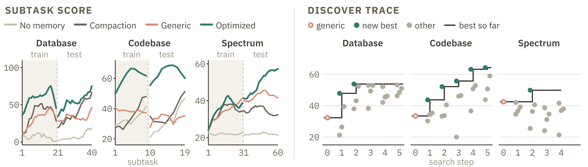

<script>
MathJax = {
  tex: {
    inlineMath: [['$', '$'], ['\\(', '\\)']],
    displayMath: [['$$', '$$'], ['\\[', '\\]']]
  }
};
</script>
<script src="https://cdn.jsdelivr.net/npm/mathjax@3/es5/tex-mml-chtml.js"></script>

<style>
.sim-figure {
  overflow-x: auto;
  margin: 1rem auto;
  text-align: center;
  -webkit-overflow-scrolling: touch;
}

.sim-figure img {
  display: block;
  width: var(--figure-width, 100%);
  max-width: 100%;
  height: auto;
  margin-inline: auto;
  cursor: zoom-in;
}

.sim-figure--pair {
  display: flex;
  gap: 2%;
  justify-content: flex-start;
}

.sim-figure--pair a {
  flex: 1 1 0;
}

.sim-figure--pair img {
  width: 100%;
}

.sim-figure-hint {
  display: none;
}

.sim-subtitle {
  margin-top: -0.75rem;
  color: #57606a;
  font-size: 1.3rem;
  line-height: 1.35;
}

@media (max-width: 700px) {
  .sim-figure img {
    width: var(--mobile-width, 760px);
    max-width: none;
    margin-inline: 0;
  }

  .sim-figure--pair img {
    width: 380px;
  }

  .sim-figure-hint {
    display: block;
    margin-top: -0.5rem;
    color: #57606a;
    font-size: 0.85rem;
  }
}
</style>

# Self-Improving Memory

<p class="sim-subtitle"><em>Meta-Optimization and Harness Distillation for Continual Learning Agents</em></p>

<a id="fig-teaser"></a>

<div class="sim-figure" style="--figure-width: 100%; --mobile-width: 900px;">
  <a href="fig1_teaser.png"></a>
</div>

<p class="sim-figure-hint">Swipe to explore the figure, or tap to open it at full size.</p>

_Figure 1. **A model (Kimi-K2.6) teaches itself better memory capabilities.** It first rewrites its own memory prompts for each task, keeping the versions that score best (harness optimization). It then runs with those prompts, swaps them back to generic ones in the recorded runs, and is fine-tuned on the result, so part of what the prompts taught moves into its weights (harness distillation). On three Continual Learning Bench tasks, its optimized prompts beat the best hand-written ones (56.0 vs 44.6). After fine-tuning, it scores 43.1 with only generic prompts, compared with 37.6 when trained on its generic-prompt runs._

## Motivation: Memory skills should be learned

**Agents can improve with experience.**
An agent that works on related tasks can pick up reusable knowledge from earlier tasks and apply it to later ones.
Persistent memory makes this possible by letting information pass beyond the boundary of a single task.
In our setting, every subtask starts in a fresh session with an empty context, and the only thing that carries over is a persistent memory directory that the agent reads and writes with file tools.

**No single memory design wins on every task.**
We ran agents on three tasks from Continual Learning Bench 1.0 (database question answering, code repair, and spectrum monitoring) with several hand-written memory designs, each built around a different memory representation.
Each design is a pair of prompts: one for offloading what the agent learned into memory after a task (a step also known as dreaming), and one for loading from memory before the next.
Echoing the findings of Continual Learning Bench, no single design is best on all tasks (Figure 2).

**So the model should learn its own memory design.**
Rather than following a hand-written design, it should decide what to write, how to organize it, and what to recall.
Self-Improving Memory does this in two stages, harness optimization and harness distillation, which we describe next.

<a id="fig-tasks-vs-harness"></a>

<div class="sim-figure" style="--figure-width: 100%; --mobile-width: 900px;">
  <a href="fig2_tasks_vs_harness.png"></a>
</div>

<p class="sim-figure-hint">Swipe to explore the figure, or tap to open it at full size.</p>

_Figure 2. **No single memory representation wins every task.** Left: the three tasks, each with an example subtask (input, tool calls, answer). Right: test scores of the generic harness and four hand-written harnesses that differ only in their memory instructions. ▼ marks the best per task._

## Method: Self-Improving Memory

Our goal is to optimize a task model's weights for continual learning tasks under a fixed generic harness.
To achieve this, we propose Self-Improving Memory, which follows a Discover-Demonstrate-Distill pipeline: a meta agent first discovers memory-management skills through harness optimization, the task agent then generates trajectories that demonstrate these skills, and finally we distill the demonstrated skills into model weights.
Because the meta agent and the task agent use the same model, this process updates the task model's weights to internalize skills discovered by the model itself.

### The generic harness

A *task agent* consists of a task model and a harness.
We use a file system as persistent memory in our *generic harness*.
The memory directory starts empty and persists throughout the task stream.
The generic harness provides file read, write, and edit tools together with two task-independent instructions.
After a subtask is scored, OFFLOAD asks the task agent to update its persistent memory using the completed interaction.
The live context is then cleared.
Before the next subtask, LOAD asks the task agent to recover useful information from the memory directory.
These instructions specify when the agent should interact with memory without prescribing a task-specific representation such as a schema table, skill library, or entity inventory.
As shown in Figure 3, files rather than a summary in the live context carry information across the subtask boundary.

<a id="fig-method"></a>

<div class="sim-figure" style="--figure-width: 100%; --mobile-width: 900px;">
  <a href="fig3_method.png"></a>
</div>

<p class="sim-figure-hint">Swipe to explore the figure, or tap to open it at full size.</p>

_Figure 3. **The generic harness and the two stages.** Left: before and after each subtask, LOAD and OFFLOAD prompts make the task agent read and update a memory directory. The context is then cleared, so only the memory files carry over. Right: (1) a meta agent revises the prompts from trajectories and scores. (2a) The agent runs with the optimized prompts, which we then replace with the generic ones. (2b) We fine-tune on these trajectories, with the loss on the model's outputs (dark blocks)._

### Harness Optimization

We discover task-specific memory-management skills by optimizing the harness instructions.
To learn effective memory designs, the agent needs guidance on what to extract from experience, how to organize it, and what to retrieve for later subtasks.
We therefore make the instructions at the LOAD and OFFLOAD stages learnable, allowing the search to shape both how the agent uses memory and how it updates memory.
We implement these instructions as two Markdown files that the harness supplies to the task model at the corresponding stages.
Our meta-optimization loop analyzes task-agent trajectories and evaluates different memory designs to find LOAD and OFFLOAD instructions that maximize the task agent's mean test score.

The meta-optimization loop consists of a *meta agent*, which analyzes trajectories and scores from the train subtasks to propose revised harness instructions, and an *outer loop*, which evaluates the resulting harnesses and uses test scores to select promising designs for further revision.
We implement this search as follows:

- **Initialize the pool.** We start with four human-written harnesses representing summary, retrieval, skill-library, and hypothesis-tracking memory designs.
- **Evaluate the harnesses.** For each unevaluated candidate, the task agent executes the full task stream five times, producing trajectories, subtask scores, and memory directories.
- **Select promising designs.** We rank the pool by mean test score across the five runs and select the top four harnesses as parents for revision.
- **Analyze experience and propose new designs.** For each parent, a meta agent receives the task-agent message lists, subtask scores, and final memory directories from the train subtasks. It identifies failures in how the task agent constructs or reuses memory and proposes instruction changes to address them. To analyze the long trajectories, it first summarizes each subtask, then analyzes each complete run, and finally consolidates evidence across runs into revised LOAD and OFFLOAD instructions. Each revised instruction pair enters the pool as a new candidate for evaluation.

We repeat this procedure for a given number of iterations and select the highest-ranking surviving harness.

### Harness Distillation

**Demonstrate.**
We turn the discovered memory-management and task-solving behaviors into training demonstrations under the generic harness.
For each task, we select the harness with the highest mean test score and run the base task model under this optimized harness on the train subtasks.
We log every language model call, including its prompt, response, reasoning content, tool calls and arguments, and the corresponding tool responses.
We then replace the optimized LOAD and OFFLOAD instructions wherever they appear in the recorded history with their generic counterparts.
This replacement works because the demonstrated behavior stays compatible with the generic instructions: the optimized harness specifies a memory design, while the generic harness leaves those choices to the model.
Compatible behaviors include *organizing memory files* (`QUICKSTART.md` for repository metadata, `REGISTRY.md` for reusable fixes, and `SCHEMA.md` for schema facts), *recording useful facts* (table relationships, column types, price units, timestamp encodings, and test commands), and *reusing problem-solving strategies* (running tests before editing, checking analogous functions, and verifying join keys before aggregation).

**Distill.**
For $K$ tasks, let $\mathcal D_k$ denote the transformed demonstrations from the train subtasks of task $k$.
We pool these demonstrations across tasks into a single dataset, reserving a validation split to monitor training.
Each demonstration $\tau$ is represented as a token sequence $x^\tau$, with generic instructions and interaction history providing context.

We finetune model weights $\theta$ by minimizing the masked next-token prediction loss:

$$
\mathcal L(\theta)
= -\frac{1}{K}\sum_{k=1}^{K}
  \frac{1}{N_k}\sum_{\tau\in\mathcal D_k}
  \sum_{i\in A_\tau}
  \log p_\theta(x_i^\tau\mid x_{\lt i}^\tau).
$$

Here $A_\tau$ indexes assistant tokens, including reasoning and tool calls, while instructions, task requests, and tool responses provide context and are masked from the loss.
The count $N_k=\sum_{\tau\in\mathcal D_k}|A_\tau|$ is the number of supervised tokens for task $k$. Normalization by $N_k$ and averaging over $K$ tasks give each task equal weight.
This objective trains the model to internalize the demonstrated capabilities in its weights and reproduce them under generic memory instructions.


## Results

We use Kimi-K2.6 for both the task agent and the meta agent, with OpenCode providing their harness and file read, write, edit, and bash tools.
For each task, we initialize the search with four human-written seed harnesses: Summary, Retrieval, Skill, and Hypothesis.
We run four search generations on Database and Codebase and three on Spectrum, generating four new harnesses per generation and evaluating each candidate over five complete task runs.
We finetune Kimi-K2.6 with LoRA applied to attention projections, using rank 8, scaling factor 16, and no dropout.

We cut each Continual Learning Bench task stream into train and test subtasks at an environment transition: Database moves to a migrated database, Codebase to new repositories, and Spectrum from wideband to narrowband activity.
The meta agent analyzes only train trajectories and distillation trains only on them. Test subtasks are used for scoring.

We compare four settings to assess the effects of persistent memory and model finetuning. *No memory* clears the base model's context at each subtask boundary with neither a summary nor a memory directory, so no information carries over between subtasks. *Summary-based compaction* summarizes the base model's context at the boundary and passes the summary to the next subtask. Under the *Generic harness*, the base model uses the task-independent LOAD and OFFLOAD instructions defined above, with files carrying information across subtask boundaries. The *Generic harness with a finetuned model* compares supervised finetuning (SFT) on two sets of trajectories: *SFT on generic trajectories*, collected with the generic harness, and *SFT on optimized trajectories* (Harness Distillation), the Self-Improving Memory model trained on optimized-harness trajectories rewritten with generic instructions. Both finetuned models use the same instructions and tools during evaluation, and the base model under the generic harness is the *No SFT* reference.

### Automatic harness optimization delivers substantial gains

We select the best observed optimized harness separately for each task.
Averaging the three selected task scores gives a mean of 56.0, an improvement of 11.4 points over the human-written seeds selected for each task and 19.9 points over Generic (Figure 4).
The optimized harnesses improve over the selected human-written seeds on all three tasks, with the largest gain on Codebase (20.6 points).
On Spectrum, Generic and Optimized have nearly the same raw first-subtask score (21.7 and 21.9), but reach test means of 42.5 and 49.9 as experience accumulates (Figure 5a).
Both the human-written seeds and optimized harnesses are selected by test score, so these are the best observed scores among evaluated candidates.

<a id="fig-harness-results"></a>

<div class="sim-figure" style="--figure-width: 100%; --mobile-width: 900px;">
  <a href="fig4_harness_results.png"></a>
</div>

<p class="sim-figure-hint">Swipe to explore the figure, or tap to open it at full size.</p>

_Figure 4. **Optimized harnesses beat the best hand-written harness on every task.** Error bars show 95% CIs. Best human-written is the best of the four hand-written harnesses for each task, and +N is the Optimized gain over it._

### Meta-optimization requires evaluation and selection

Across the completed searches (Figure 5b), 37 of 44 generated revisions fail to beat the best score from previous iterations.
Database and Spectrum reach 53.8 and 49.9 in the first search generation and make no further gains, while Codebase improves through the fourth generation to 64.3.
Progress therefore depends on evaluating proposals and retaining the best observed designs.

<a id="fig-learning-search"></a>

<div class="sim-figure" style="--figure-width: 100%; --mobile-width: 900px;">
  <a href="fig5_learning_and_search.png"></a>
</div>

<p class="sim-figure-hint">Swipe to explore the figure, or tap to open it at full size.</p>

_Figure 5. **Learning across subtasks, and search progress.** Left: subtask scores for the runs in Figure 4, where the dashed line marks the train/test environment shift. Right: each dot is one evaluated harness (iteration 0: Generic, iteration 1: hand-written seeds, iterations 2 and later: harnesses proposed by the meta agent). The line tracks the best score so far._

### Case Study of Meta-Optimization

Figure 6 illustrates how trajectory reports guide revisions of the Codebase memory harness.
The Summary harness scores 34.3, barely above Generic at 33.5 and well below the best seed at 43.7. Its report identifies growing monolithic notes and repeated repository discovery.
A revision that reuses recorded paths and retains failure rules scores 52.2.
The next report diagnoses an append-only file without an index mapping symptoms to fixes, and a revision with a compact quickstart, an indexed registry, and separate fix files scores 55.7.
An alternative Summary revision that retains details of only the last two fixes scores 36.6.

<a id="fig-case-meta-optimization"></a>

<div class="sim-figure" style="--figure-width: 100%; --mobile-width: 900px;">
  <a href="fig6_case_study.png"></a>
</div>

<p class="sim-figure-hint">Swipe to explore the figure, or tap to open it at full size.</p>

_Figure 6. **How the meta agent revises the Codebase harness.** Each box shows a harness's LOAD and OFFLOAD prompts and test score. Each report diagnoses that harness's trajectories and motivates the next revision. Underlines mark the key changes._

### Training internalizes part of these gains

We finetune on demonstrations from train subtasks and evaluate generalization to test subtasks of the same tasks after domain shifts.
We compare SFT on optimized trajectories (Harness Distillation), trained on optimized-harness trajectories rewritten with generic instructions, with SFT on generic trajectories, trained on generic-harness trajectories. Both use the same LoRA recipe and are evaluated with the generic harness.
Across ten matched evaluation seeds, Harness Distillation reaches an overall mean test score of 43.1 versus 37.6 for SFT on generic trajectories, a gain of 5.5 points (14.7%, Figure 7).
Its 7.0-point gain over No SFT (36.1, the same reference evaluation as Generic in Figure 4) is descriptive because the base model was evaluated separately.
The improved test scores show that the finetuned model generalizes within the same tasks under domain shift, using generic memory instructions.
We hypothesize that the gain partly reflects improved memory organization and retrieval, alongside task-solving behavior, but isolating this mechanism requires direct behavioral analysis.

<a id="fig-distillation-results"></a>

<div class="sim-figure" style="--figure-width: 100%; --mobile-width: 900px;">
  <a href="fig7_distillation.png"></a>
</div>

<p class="sim-figure-hint">Swipe to explore the figure, or tap to open it at full size.</p>

_Figure 7. **Harness distillation moves part of the gain into the model's weights.** All models run with the generic harness. SFT on generic trajectories trains on generic-harness runs, and SFT on optimized trajectories trains on optimized-harness runs with the prompts swapped back to generic. Error bars show 95% CIs, and +N is the gain over No SFT._

## Conclusion

We present Self-Improving Memory, which improves a model's memory-management performance by training it on better memory-management trajectories.
We achieve this with a Discover-Demonstrate-Distill pipeline: the model discovers memory instructions tailored to each task, demonstrates them in its own trajectories, and is finetuned on those demonstrations so that it manages memory under a single generic harness.
We observe that automatically optimized harnesses outperform human-written ones (56.0 versus 44.6 for the best human-written seed and 36.1 for Generic), and that distillation carries part of these gains into the model weights (43.1 versus 37.6 for training on generic-harness trajectories).
We hope future work scales this approach to more agent capabilities beyond memory and to a wider range of tasks and models.

## Contributors
Tong Chen, Chuanyang Jin, Eryk Helenowski, Weizhe Yuan, Jason Weston, Ilia Kulikov, Xian Li, Swarnadeep Saha

## Citation
To reference the work in this blog post, please use the following BibTex entry:

```bibtex
@online{chen2026selfimprovingmemory,
  title  = {Self-Improving Memory: Meta-Optimization and Harness Distillation for Continual Learning Agents},
  author = {Tong Chen and Chuanyang Jin and Eryk Helenowski and Weizhe Yuan and Jason Weston and Ilia Kulikov and Xian Li and Swarnadeep Saha},
  year   = {2026},
  url    = {https://facebookresearch.github.io/RAM/blogs/self_improving_memory/}
}
```
