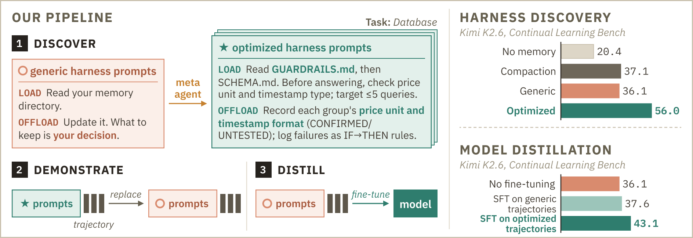
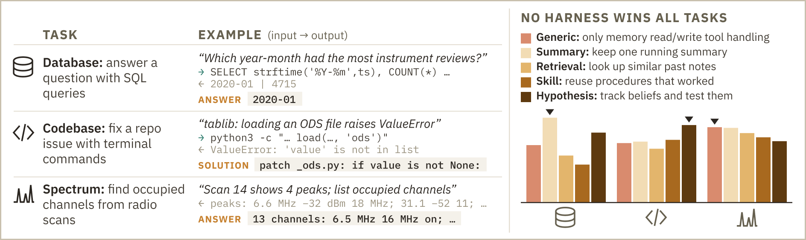
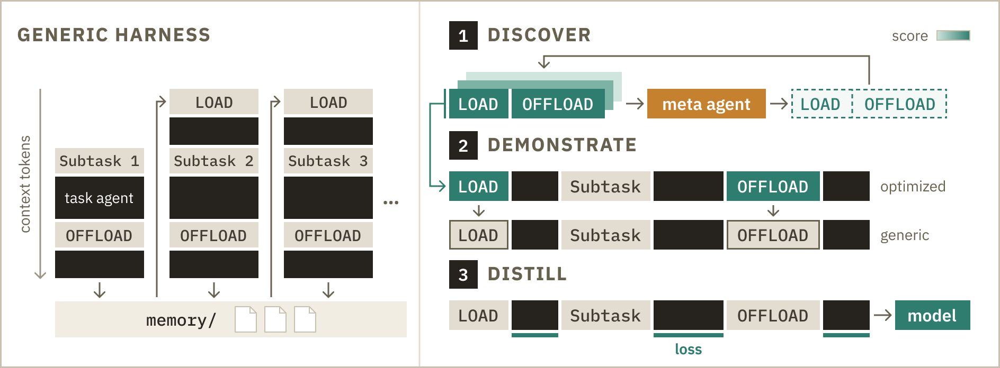
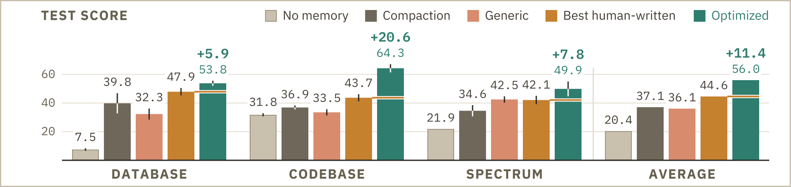
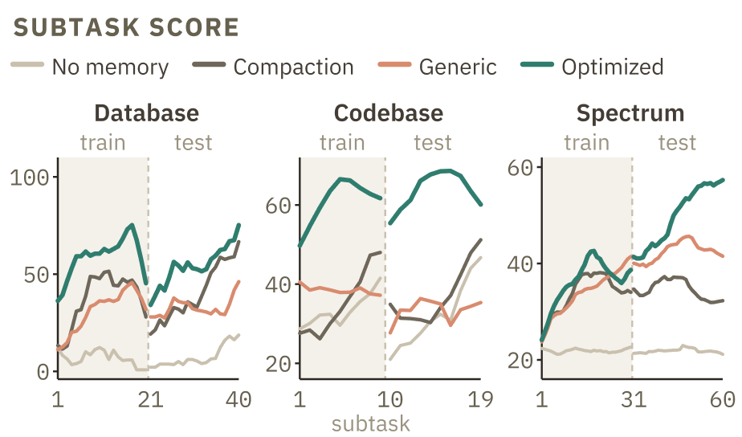
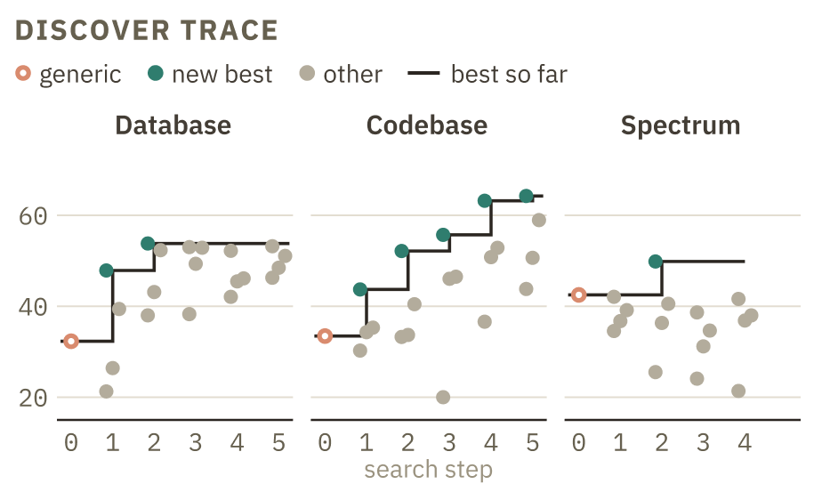
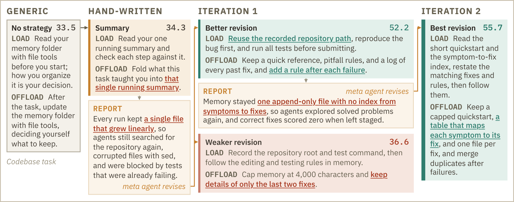
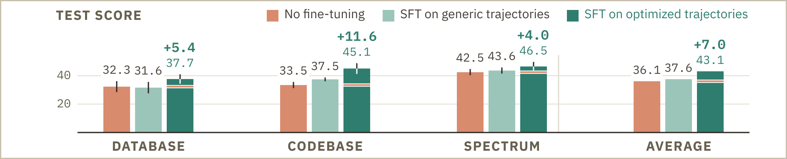

<script>
MathJax = {
  tex: {
    inlineMath: [['$', '$'], ['\\(', '\\)']],
    displayMath: [['$$', '$$'], ['\\[', '\\]']]
  }
};
</script>
<script src="https://cdn.jsdelivr.net/npm/mathjax@3/es5/tex-mml-chtml.js"></script>

<style>
.sim-figure {
  overflow-x: auto;
  margin: 1rem auto;
  text-align: center;
  -webkit-overflow-scrolling: touch;
}

.sim-figure img {
  display: block;
  width: var(--figure-width, 100%);
  max-width: 100%;
  height: auto;
  margin-inline: auto;
  cursor: zoom-in;
}

.sim-figure--pair {
  display: flex;
  gap: 2%;
  justify-content: center;
}

.sim-figure--pair a {
  flex: 1 1 0;
}

.sim-figure--pair img {
  width: 100%;
}

.sim-figure-hint {
  display: none;
}

@media (max-width: 700px) {
  .sim-figure img {
    width: var(--mobile-width, 760px);
    max-width: none;
    margin-inline: 0;
  }

  .sim-figure--pair img {
    width: 380px;
  }

  .sim-figure-hint {
    display: block;
    margin-top: -0.5rem;
    color: #57606a;
    font-size: 0.85rem;
  }
}
</style>

# Self-Improving Memory: Meta-Optimization and Harness Distillation for Continual Learning Agents

<a id="fig-teaser"></a>

<div class="sim-figure" style="--figure-width: 100%; --mobile-width: 900px;">
  <a href="fig1_teaser.png"></a>
</div>

<p class="sim-figure-hint">Swipe to explore the figure; tap to open it at full size.</p>

_Figure 1. **Self-Improving Memory.** Self-Improving Memory discovers guidance for each task, demonstrates the resulting capabilities in training trajectories, and distills them into model weights for use under a generic harness._

## Overview

**Motivation.**
Our goal is a self-improvement framework that automatically improves how language models use memory across tasks, with minimal human effort.
In our setting, an agent solves a stream of related subtasks and learns to use persistent files to store experience that improves its later decisions.
However, effective memory use today usually depends on a hand-engineered harness that tells the agent what to extract from experience, how to organize it, and what to retrieve. Among the harnesses we evaluate, no single harness performs best on all tasks, so each task needs its own design, and designing these by hand does not scale to the wide range of real applications.
These observations motivate our approach: automatically discovering a memory workflow tailored to each task, and internalizing it into the model's weights.

**Our contribution.**
In this work, we propose Self-Improving Memory, which uses LMs as meta-optimizers to automatically design memory harnesses and then trains the resulting memory behavior into the model's weights.
The same model serves as both the meta agent and the task agent, so it improves itself by learning from memory behaviors that it discovered and demonstrated.
Self-Improving Memory follows a three-step Discover-Demonstrate-Distill pipeline (Figure 1).
In the Discover step, the meta-agent analyzes task trajectories and revises the LOAD and OFFLOAD prompts tailored to each task.
In the Demonstrate step, the task agent follows the optimized harness to generate trajectories, in which we then replace the optimized prompts with their generic counterparts.
Finally in the Distill step, we pool these demonstrations across tasks and finetune the model on them, so it reproduces the demonstrated memory behavior under generic instructions.
At deployment, the generic harness provides only tool-handling instructions, and the model itself decides how to construct, update, and retrieve memory.

We evaluate Self-Improving Memory with Kimi-K2.6 on three Continual Learning Bench tasks: database exploration, codebase adaptation, and spectrum monitoring.
Kimi-K2.6 serves as the meta agent that optimizes the harness, the task agent that generates demonstrations, and the model we finetune, so all improvements come from the model itself.
First, automatically discovered harnesses outperform human-written ones: with the base model, the best optimized harness for each task achieves a mean test score of **56.0**, compared with **44.6** for the best human-written seed harness.
Second, training internalizes part of these gains: under generic memory instructions, the model trained with Self-Improving Memory achieves a mean test score of **43.1**, compared with **37.6** when finetuning on generic-harness trajectories and **36.1** for the base model.
Together, these results suggest that memory design can be automated, and that the discovered memory behavior can be trained into a model that then needs only a generic harness.

## No single harness wins all tasks

We evaluate on three tasks from Continual Learning Bench that require different kinds of reusable knowledge, as shown in Figure 2.
**Database** asks the agent to answer natural-language questions by querying an unknown SQLite database. Its score rewards correct answers with fewer exploratory queries.
**Codebase** asks the agent to repair bugs in Python repositories and submit patches. Its score rewards patches that pass evaluation tests with fewer commands.
**Spectrum** asks the agent to infer persistent transmitters from noisy radio scans. Its score measures the intersection-over-union of predicted and true available spectrum.
Memory helps the database agent reuse schema facts instead of repeating exploratory queries, and the codebase agent apply repair procedures learned from earlier issues.
For spectrum monitoring, retaining observations across scans helps distinguish temporarily inactive transmitters from unoccupied spectrum.

We split each task stream at an environment transition in the benchmark's default schedule.
Database uses the original database for training and the migrated database for testing, while Codebase uses different repositories for the two splits.
Spectrum uses the initial phase dominated by wideband activity for training and the subsequent phase with more active narrowband channels for testing.
The train subtasks supply the trajectories used for harness revision and model training, while the test subtasks are used to measure performance.

With the model and memory interface fixed, we select the best human-written seed separately for each task.
Averaging the three selected task scores gives an overall mean of 44.6, compared with 36.1 for Generic (Figure 4).
Relative to Generic, the selected seeds score 15.6 points higher on Database, 10.2 points higher on Codebase, and 0.4 points lower on Spectrum.
These results motivate discovering memory guidance tailored to each task.

<a id="fig-tasks-vs-harness"></a>

<div class="sim-figure" style="--figure-width: 100%; --mobile-width: 900px;">
  <a href="fig2_tasks_vs_harness.png"></a>
</div>

<p class="sim-figure-hint">Swipe to explore the figure; tap to open it at full size.</p>

_Figure 2. **No single harness wins all tasks.** Left: the three tasks with an example subtask (input, intermediate tool calls, and the submitted answer or solution). Right: test scores of the generic harness and four human-written harnesses; a triangle marks the best of the five per task._

## Self-Improving Memory

Our goal is to optimize a task model's weights for continual learning tasks under a fixed generic harness.
To achieve this, we propose Self-Improving Memory, which follows a Discover-Demonstrate-Distill pipeline: a meta agent first discovers memory-management skills through harness optimization; the task agent then generates trajectories that demonstrate these skills; finally, we distill the demonstrated skills into model weights.
Because the meta agent and the task agent use the same model, this process updates the task model's weights to internalize skills discovered by the model itself.

### The generic harness

A *task agent* consists of a task model and a harness.
We use a file system as persistent memory in our *generic harness*.
The memory directory starts empty and persists throughout the task stream.
The generic harness provides file read, write, and edit tools together with two task-independent instructions.
After a subtask is scored, OFFLOAD asks the task agent to update its persistent memory using the completed interaction.
The live context is then cleared.
Before the next subtask, LOAD asks the task agent to recover useful information from the memory directory.
These instructions specify when the agent should interact with memory without prescribing a task-specific representation such as a schema table, skill library, or entity inventory.
As shown in Figure 3, files rather than a summary in the live context carry information across the subtask boundary.

<a id="fig-method"></a>

<div class="sim-figure" style="--figure-width: 100%; --mobile-width: 900px;">
  <a href="fig3_method.png"></a>
</div>

<p class="sim-figure-hint">Swipe to explore the figure; tap to open it at full size.</p>

_Figure 3. Self-Improving Memory learns memory-management behavior while keeping the generic harness fixed at deployment._

### Discover: Harness Optimization

We discover task-specific memory-management skills by optimizing the harness instructions.
To learn effective memory designs, the agent needs guidance on what to extract from experience, how to organize it, and what to retrieve for later subtasks.
We therefore make the instructions at the LOAD and OFFLOAD stages learnable, allowing the search to shape both how the agent uses memory and how it updates memory.
We implement these instructions as two Markdown files that the harness supplies to the task model at the corresponding stages.
Our meta-optimization loop analyzes task-agent trajectories and evaluates different memory designs to find LOAD and OFFLOAD instructions that maximize the task agent's mean test score.

The meta-optimization loop consists of a *meta agent*, which analyzes trajectories and scores from the train subtasks to propose revised harness instructions, and an *outer loop*, which evaluates the resulting harnesses and uses test scores to select promising designs for further revision.
We implement this search as follows:

- **Initialize the pool.** We start with four human-written harnesses representing summary, retrieval, skill-library, and hypothesis-tracking memory designs.
- **Evaluate the harnesses.** For each unevaluated candidate, the task agent executes the full task stream five times, producing trajectories, subtask scores, and memory directories.
- **Select promising designs.** We rank the pool by mean test score across the five runs and select the top four harnesses as parents for revision.
- **Analyze experience and propose new designs.** For each parent, a meta agent receives the task-agent message lists, subtask scores, and final memory directories from the train subtasks. It identifies failures in how the task agent constructs or reuses memory and proposes instruction changes to address them. To analyze the long trajectories, it first summarizes each subtask, then analyzes each complete run, and finally consolidates evidence across runs into revised LOAD and OFFLOAD instructions. Each revised instruction pair enters the pool as a new candidate for evaluation.

We repeat this procedure for a given number of iterations and select the highest-ranking surviving harness.

### Demonstrate: Trajectory Construction

We turn the discovered memory-management and task-solving behaviors into training demonstrations under the generic harness.
For each task, we select the harness with the highest mean test score and run the base task model under this optimized harness on the train subtasks.
We log every language model call, including its prompt, response, reasoning content, tool calls and arguments, and the corresponding tool responses.
We then replace the optimized LOAD and OFFLOAD instructions wherever they appear in the recorded history with their generic counterparts.
The resulting trajectories demonstrate how to manage memory and solve tasks when prompted with only generic instructions.

Instruction replacement requires the demonstrated behavior to remain compatible with the new instructions.
In our case, the optimized harness specifies a memory design, while the generic harness leaves those choices to the model.
Compatible behaviors include *organizing memory files* (`QUICKSTART.md` for repository metadata, `REGISTRY.md` for reusable fixes, and `SCHEMA.md` for schema facts), *recording useful facts* (table relationships, column types, price units, timestamp encodings, and test commands), and *reusing problem-solving strategies* (running tests before editing, checking analogous functions, and verifying join keys before aggregation).

### Distill: Model Finetuning

For $K$ tasks, let $\mathcal D_k$ denote the transformed demonstrations from the train subtasks of task $k$.
We pool these demonstrations across tasks into a single dataset, reserving a validation split to monitor training.
Each demonstration $\tau$ is represented as a token sequence $x^\tau$, with generic instructions and interaction history providing context.

We finetune model weights $\theta$ by minimizing the masked next-token prediction loss:

$$
\mathcal L(\theta)
= -\frac{1}{K}\sum_{k=1}^{K}
  \frac{1}{N_k}\sum_{\tau\in\mathcal D_k}
  \sum_{i\in A_\tau}
  \log p_\theta(x_i^\tau\mid x_{<i}^\tau).
$$

Here $A_\tau$ indexes assistant tokens, including reasoning and tool calls, while instructions, task requests, and tool responses provide context and are masked from the loss.
The count $N_k=\sum_{\tau\in\mathcal D_k}|A_\tau|$ is the number of supervised tokens for task $k$; normalization by $N_k$ and averaging over $K$ tasks give each task equal weight.
This objective trains the model to internalize the demonstrated capabilities in its weights and reproduce them under generic memory instructions.

## Results

We use Kimi-K2.6 for both the task agent and the meta agent, with OpenCode providing their harness and file read, write, edit, and bash tools.
For each task, we initialize the search with four human-written seed harnesses: Summary, Retrieval, Skill, and Hypothesis.
We run four search generations on Database and Codebase and three on Spectrum, generating four new harnesses per generation and evaluating each candidate over five complete task runs.
We finetune Kimi-K2.6 with LoRA applied to attention projections, using rank 8, scaling factor 16, and no dropout.

We compare four settings to assess the effects of persistent memory and model finetuning. *No memory* clears the base model's context at each subtask boundary with neither a summary nor a memory directory, so no information carries over between subtasks. *Summary-based compaction* summarizes the base model's context at the boundary and passes the summary to the next subtask. Under the *Generic harness*, the base model uses the task-independent LOAD and OFFLOAD instructions defined above, with files carrying information across subtask boundaries. The *Generic harness with a finetuned model* compares supervised finetuning (SFT) on two sets of trajectories: *SFT on generic trajectories*, collected with the generic harness, and *SFT on optimized trajectories* (Harness Distillation), the Self-Improving Memory model trained on optimized-harness trajectories rewritten with generic instructions; both finetuned models use the same instructions and tools during evaluation, and the base model under the generic harness is the *No fine-tuning* reference.

### Automatic harness optimization delivers substantial gains

We select the best observed optimized harness separately for each task.
Averaging the three selected task scores gives a mean of 56.0, an improvement of 11.4 points over the human-written seeds selected for each task and 19.9 points over Generic (Figure 4).
The optimized harnesses improve over the selected human-written seeds on all three tasks, with the largest gain on Codebase (20.6 points).
On Spectrum, Generic and Optimized have nearly the same raw first-subtask score (21.7 and 21.9), but reach test means of 42.5 and 49.9 as experience accumulates (Figure 5a).
Both the human-written seeds and optimized harnesses are selected by test score, so these are the best observed scores among evaluated candidates.

<a id="fig-harness-results"></a>

<div class="sim-figure" style="--figure-width: 100%; --mobile-width: 900px;">
  <a href="fig4_harness_results.png"></a>
</div>

<p class="sim-figure-hint">Swipe to explore the figure; tap to open it at full size.</p>

_Figure 4. **The optimized harnesses improve over the selected human-written seeds on all three tasks.** Harness optimization results. +N is the gain over the best human-written harness per task._

### Meta-optimization requires evaluation and selection

Across the completed searches (Figure 5b), 37 of 44 generated revisions fail to beat the best score from previous iterations.
Database and Spectrum reach 53.8 and 49.9 in the first search generation and make no further gains, while Codebase improves through the fourth generation to 64.3.
Progress therefore depends on evaluating proposals and retaining the best observed designs.

<a id="fig-learning-search"></a>

<div class="sim-figure sim-figure--pair">
  <a href="fig5a_subtask_curves.png"></a>
  <a href="fig5b_search_trace.png"></a>
</div>

<p class="sim-figure-hint">Swipe to explore the figure; tap to open it at full size.</p>

_Figure 5. Learning across subtasks and progress of harness optimization. (a) Performance across subtasks. Curves use the same runs as the bars in Figure 4 and are smoothed separately on each side of the train/test transition. (b) Progress of harness optimization. Each point is one evaluated harness; the step line shows the best observed score. Steps 0 and 1 denote Generic and human-written seeds; subsequent steps are search iterations._

### Case Study of Meta-Optimization

Figure 6 illustrates how trajectory reports guide revisions of the Codebase memory harness.
The Summary harness scores 34.3, barely above Generic at 33.5 and well below the best seed at 43.7; its report identifies growing monolithic notes and repeated repository discovery.
A revision that reuses recorded paths and retains failure rules scores 52.2.
The next report diagnoses an append-only file without an index mapping symptoms to fixes; a revision with a compact quickstart, an indexed registry, and separate fix files scores 55.7.
An alternative Summary revision that retains details of only the last two fixes scores 36.6.

<a id="fig-case-meta-optimization"></a>

<div class="sim-figure" style="--figure-width: 100%; --mobile-width: 900px;">
  <a href="fig6_case_study.png"></a>
</div>

<p class="sim-figure-hint">Swipe to explore the figure; tap to open it at full size.</p>

_Figure 6. Revisions of the Codebase memory harness guided by trajectory reports. Reports identify repeated exploration and missing retrieval structure, motivating changes to LOAD and OFFLOAD._

### Training internalizes part of these gains

We finetune on demonstrations from train subtasks and evaluate generalization to test subtasks of the same tasks after domain shifts.
We compare SFT on optimized trajectories (Harness Distillation), trained on optimized-harness trajectories rewritten with generic instructions, with SFT on generic trajectories, trained on generic-harness trajectories; both use the same LoRA recipe and are evaluated with the generic harness.
Across ten matched evaluation seeds, Harness Distillation reaches an overall mean test score of 43.1 versus 37.6 for SFT on generic trajectories, a gain of 5.5 points (14.7%; Figure 7).
Its 7.0-point gain over No fine-tuning (36.1, the same reference evaluation as Generic in Figure 4) is descriptive because the base model was evaluated separately.
The improved test scores show that the finetuned model generalizes within the same tasks under domain shift, using generic memory instructions.
We hypothesize that the gain partly reflects improved memory organization and retrieval, alongside task-solving behavior; isolating this mechanism requires direct behavioral analysis.

<a id="fig-distillation-results"></a>

<div class="sim-figure" style="--figure-width: 100%; --mobile-width: 900px;">
  <a href="fig7_distillation.png"></a>
</div>

<p class="sim-figure-hint">Swipe to explore the figure; tap to open it at full size.</p>

_Figure 7. **The generic-trajectory control suggests that optimized harnesses produce more effective demonstrations for a model deployed with generic instructions.** Model distillation under generic instructions. All models are evaluated with the generic harness; SFT on optimized trajectories (Harness Distillation) finetunes on optimized-harness trajectories whose instructions are replaced with the generic ones. +N is the gain over No fine-tuning._

## Conclusion and Next Steps

We presented Self-Improving Memory, which trains a model to manage memory rather than providing a task-specific harness.
Using the same model as meta agent and task agent, it discovers memory instructions, generates demonstrations under optimized harnesses, and distills the demonstrated behavior into model weights for use under generic instructions.
Across three Continual Learning Bench tasks, optimized harnesses reach a mean test score of 56.0, compared with 44.6 for the best human-written seed and 36.1 for Generic.
In a separate evaluation with matched seeds and generic instructions, Harness Distillation reaches 43.1 versus 37.6 for training on generic-harness trajectories, a gain of 14.7%.
Together, these results support using agent trajectory analysis to discover behaviors and produce demonstrations that improve subsequent task models.

**Distillation under generic instructions.**
The generic-trajectory control suggests that optimized harnesses produce more effective demonstrations for a model deployed with generic instructions.
Because the demonstrations also contain task-solving procedures, controls that isolate memory behavior are needed to identify which behaviors account for the gain.

**Limits of the evidence.**
Optimized instructions can also encode task knowledge: the selected Database LOAD prompt specifies dataset mappings and timestamp and price units.
These instruction pairs jointly specify memory use and procedures for solving tasks, leaving their separate contributions unresolved.
The reported optimized harnesses and best seeds are selected using the same test scores used for reporting, which introduces selection bias.
An independent evaluation split is needed to assess generalization after selection.
Our study uses one model backend and three task streams; testing additional models and environments remains necessary before claiming broad applicability.

Progress depends on evaluation and selection, while generalization and the specific contribution of memory skills remain open.
Future work should test fresh task streams and additional models, and determine whether repeating discovery, demonstration, and distillation yields further improvement.

## Contributors
Tong Chen, Chuanyang Jin, Eryk Helenowski, Weizhe Yuan, Jason Weston, Ilia Kulikov, Xian Li, Swarnadeep Saha

<!-- TODO before PR: replace with the arXiv link and section number of the joint report once it is public. -->
## More details
We plan to put a full technical report on arXiv soon.

## Citation
To reference the work in this blog post, please use the following BibTex entry:

```bibtex
@online{chen2026selfimprovingmemory,
  title  = {Self-Improving Memory: Meta-Optimization and Harness Distillation for Continual Learning Agents},
  author = {Tong Chen and Chuanyang Jin and Eryk Helenowski and Weizhe Yuan and Jason Weston and Ilia Kulikov and Xian Li and Swarnadeep Saha},
  year   = {2026},
  url    = {https://facebookresearch.github.io/RAM/blogs/self_improving_memory/}
}
```
